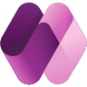
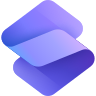

# Catálogo de Ícones Microsoft

> Ícones oficiais Microsoft para uso nos diagramas de arquitetura e equipe.  
> Uso em markdown via HTML: ``  
> Uso em Mermaid `architecture-beta`: equivalente Iconify na coluna "Mermaid Alt"

---

## Power Platform Icons

| Ícone | Arquivo | Uso no Projeto | HTML Tag |
|-------|---------|---------------|---------|
|  | `PowerPlatform_scalable.svg` | Plataforma geral | `` |
|  | `PowerApps_scalable.svg` | Aplicações low-code | `` |
|  | `PowerAutomate_scalable.svg` | Automação de fluxos | `` |
|  | `PowerPages_scalable.svg` | Portais web | `` |
|  | `Dataverse_scalable.svg` | Armazenamento de dados | `` |
|  | `AIBuilder_scalable.svg` | IA e modelos | `` |
|  | `CopilotStudio_scalable.svg` | Agentes e Copilot | `` |
|  | `Agent365_scalable.svg` | Agente Microsoft 365 | `` |

---

## Microsoft 365 Icons — Equipe e Papéis

| Ícone | Arquivo | Papel Sugerido | Mermaid Alt |
|-------|---------|---------------|------------|
|  | `Person.svg` | Usuário / Stakeholder | `mdi:account` |
|  | `People.svg` | Time / Grupo | `mdi:account-group` |
|  | `People Team.svg` | Squad de desenvolvimento | `mdi:account-multiple` |
|  | `Person Settings.svg` | Admin / Config | `mdi:account-cog` |
|  | `Person Wrench.svg` | Dev / Engenheiro | `mdi:account-wrench` |
|  | `Hat Graduation.svg` | Arquiteto / Especialista | `mdi:school` |
|  | `Presenter.svg` | Product Owner / PM | `mdi:presentation` |
|  | `Headset.svg` | Suporte / Customer Success | `mdi:headset` |
|  | `People Settings.svg` | DevOps / SRE | `mdi:account-cog` |
|  | `People Community.svg` | Stakeholders / Comunidade | `mdi:account-group` |

---

## Microsoft 365 Icons — Infraestrutura

| Ícone | Arquivo | Conceito | Mermaid Alt (`azure:` / `mdi:`) |
|-------|---------|---------|--------------------------------|
|  | `Cloud.svg` | Cloud / Azure | `azure:azure` |
|  | `Cloud Database.svg` | Banco na nuvem | `azure:sql-database` |
|  | `Database.svg` | Banco de dados | `mdi:database` |
|  | `Cloud Desktop.svg` | Aplicação cloud | `azure:app-service` |
|  | `Code.svg` | Código / API | `mdi:code-braces` |
|  | `Bot.svg` | Bot / IA | `azure:cognitive-services` |
|  | `Building Cloud.svg` | Enterprise na nuvem | `azure:azure` |
|  | `Deploy.svg` | CI/CD / Deploy | `azure:devops` |
|  | `Arrow Sync.svg` | Integração / Sync | `mdi:sync` |

---

## Microsoft 365 Icons — Segurança

| Ícone | Arquivo | Conceito | Mermaid Alt |
|-------|---------|---------|------------|
|  | `Lock Shield.svg` | Segurança / RBAC | `azure:key-vault` |
|  | `Fingerprint.svg` | Biometria / MFA | `azure:azure-active-directory` |
|  | `Key.svg` | Chaves / Secrets | `azure:key-vault` |
|  | `Shield Error.svg` | Vulnerabilidade | `mdi:shield-alert` |
|  | `Certificate.svg` | TLS / Certificados | `mdi:certificate` |

---

## Microsoft 365 Icons — Processo e Documentação

| Ícone | Arquivo | Conceito | Mermaid Alt |
|-------|---------|---------|------------|
|  | `Clipboard Task List.svg` | Tasks / Backlog | `mdi:clipboard-list` |
|  | `Calendar Month.svg` | Sprint / Timeline | `mdi:calendar` |
|  | `Clock.svg` | Tempo / Estimativa | `mdi:clock` |
|  | `Chart Multiple.svg` | Métricas / KPIs | `mdi:chart-bar` |
|  | `Data Trending.svg` | Analytics | `azure:application-insights` |
|  | `Lightbulb Checkmark.svg` | Decisão / ADR | `mdi:lightbulb-on` |
|  | `Handshake.svg` | Contrato / SLA | `mdi:handshake` |

---

## Como Usar em Mermaid `architecture-beta`

```mermaid
architecture-beta
  %% Use azure: ou mdi: como alternativas Iconify
  %% Os ícones Microsoft originais são referenciados via HTML separado

  group cloud(azure:azure)[Azure Cloud]
  service api(azure:api-management)[API Management] in cloud
  service db(azure:sql-database)[SQL Database] in cloud
  service auth(azure:azure-active-directory)[Entra ID] in cloud
```



## Como Usar em HTML (ícones originais Microsoft)

```html
<div align="center">
<table>
<tr>
  <td align="center">
    <br>
    <b>Power Platform</b>
  </td>
  <td align="center">
    <br>
    <b>Dev</b>
  </td>
</tr>
</table>
</div>
```
