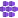
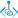
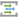

# Catálogo de Ícones Azure Oficiais (V23)

> **705 SVGs** oficiais Microsoft, organizados em 30 categorias.  
> Versão: Azure Public Service Icons V23 (Nov 2025)  
> Uso em markdown: ``  
> Uso em Mermaid `architecture-beta`: coluna "Mermaid Iconify"

---

## Legenda de Status de Uso

| Status | Significado |
|--------|------------|
| ⭐ | Mais usados em arquiteturas de solução |
| 🔵 | Uso comum em projetos enterprise |
| ⚪ | Especializado / contexto específico |

---

## 🖥️ Compute

| Ícone | Nome Amigável | Arquivo SVG | Mermaid Iconify | Uso |
|-------|--------------|------------|----------------|-----|
|  | App Service | `compute/10035-icon-service-App-Services.svg` | `azure:app-service` | ⭐ Web apps, APIs |
|  | Function Apps | `compute/10029-icon-service-Function-Apps.svg` | `azure:functions` | ⭐ Serverless |
|  | AKS | `compute/10023-icon-service-Kubernetes-Services.svg` | `azure:kubernetes-service` | ⭐ Orquestração containers |
|  | Virtual Machine | `compute/10021-icon-service-Virtual-Machine.svg` | `azure:virtual-machines` | 🔵 IaaS |
|  | VM Scale Sets | `compute/10034-icon-service-VM-Scale-Sets.svg` | `azure:virtual-machine-scale-sets` | 🔵 Auto-scaling VMs |
|  | Container Instances | `compute/10104-icon-service-Container-Instances.svg` | `azure:container-instances` | 🔵 Containers sem orquestração |
|  | Azure Spring Apps | `compute/10370-icon-service-Azure-Spring-Apps.svg` | `mdi:leaf` | ⚪ Java Spring |

---

## 🌐 Networking

| Ícone | Nome Amigável | Arquivo SVG | Mermaid Iconify | Uso |
|-------|--------------|------------|----------------|-----|
|  | Front Door + CDN | `networking/10073-icon-service-Front-Door-and-CDN-Profiles.svg` | `azure:front-door` | ⭐ Edge, WAF, CDN global |
|  | Application Gateway | `networking/10076-icon-service-Application-Gateways.svg` | `azure:application-gateway` | ⭐ L7 LB + WAF |
|  | Load Balancer | `networking/10062-icon-service-Load-Balancers.svg` | `azure:load-balancer` | ⭐ L4 balanceamento |
|  | Virtual Network | `networking/10061-icon-service-Virtual-Networks.svg` | `azure:virtual-network` | ⭐ Rede privada |
|  | Firewall | `networking/10084-icon-service-Firewalls.svg` | `azure:azure-firewall` | ⭐ Segurança de rede |
|  | NSG | `networking/10067-icon-service-Network-Security-Groups.svg` | `mdi:security-network` | ⭐ Regras de tráfego |
|  | Private Link | `networking/00427-icon-service-Private-Link.svg` | `mdi:link-lock` | 🔵 Acesso privado a PaaS |
|  | VPN Gateway | `networking/10063-icon-service-Virtual-Network-Gateways.svg` | `mdi:vpn` | 🔵 Conectividade híbrida |
|  | Traffic Manager | `networking/10065-icon-service-Traffic-Manager-Profiles.svg` | `mdi:traffic-light` | ⚪ DNS load balancing global |
|  | Bastion | `networking/02422-icon-service-Bastions.svg` | `mdi:shield-key` | 🔵 Acesso seguro a VMs |
|  | DDoS Protection | `networking/10072-icon-service-DDoS-Protection-Plans.svg` | `mdi:shield-check` | 🔵 Proteção DDoS |
|  | NAT Gateway | `networking/10310-icon-service-NAT.svg` | `mdi:router-network` | ⚪ Saída internet segura |

---

## 🗄️ Databases

| Ícone | Nome Amigável | Arquivo SVG | Mermaid Iconify | Uso |
|-------|--------------|------------|----------------|-----|
|  | Azure SQL Database | `databases/10130-icon-service-SQL-Database.svg` | `azure:sql-database` | ⭐ Banco relacional PaaS |
|  | Cosmos DB | `databases/10121-icon-service-Azure-Cosmos-DB.svg` | `azure:cosmos-db` | ⭐ NoSQL multi-modelo global |
|  | Redis Cache | `databases/10137-icon-service-Cache-Redis.svg` | `azure:cache-for-redis` | ⭐ Cache em memória |
|  | PostgreSQL | `databases/10131-icon-service-Azure-Database-PostgreSQL-Server.svg` | `mdi:elephant` | 🔵 PostgreSQL gerenciado |
|  | MySQL | `databases/10122-icon-service-Azure-Database-MySQL-Server.svg` | `mdi:database` | 🔵 MySQL gerenciado |
|  | SQL Managed Instance | `databases/10136-icon-service-SQL-Managed-Instance.svg` | `azure:sql-managed-instance` | 🔵 SQL Server PaaS |
|  | Azure SQL | `databases/02390-icon-service-Azure-SQL.svg` | `azure:sql-database` | ⭐ Família SQL Azure |
|  | Synapse Analytics | `databases/00606-icon-service-Azure-Synapse-Analytics.svg` | `azure:synapse-analytics` | 🔵 Data warehouse + analytics |

---

## 💾 Storage

| Ícone | Nome Amigável | Arquivo SVG | Mermaid Iconify | Uso |
|-------|--------------|------------|----------------|-----|
|  | Storage Accounts | `storage/10086-icon-service-Storage-Accounts.svg` | `azure:storage-accounts` | ⭐ Blob, Table, Queue, Files |
|  | Data Lake | `storage/10090-icon-service-Data-Lake-Storage-Gen1.svg` | `mdi:database-outline` | 🔵 Big Data storage |
|  | Recovery Services | `storage/00017-icon-service-Recovery-Services-Vaults.svg` | `mdi:backup-restore` | 🔵 Backup e DR |
|  | Azure Files | `storage/10400-icon-service-Azure-Fileshares.svg` | `mdi:folder-network` | 🔵 SMB/NFS na nuvem |

---

## 🔐 Security & Identity

| Ícone | Nome Amigável | Arquivo SVG | Mermaid Iconify | Uso |
|-------|--------------|------------|----------------|-----|
|  | Key Vault | `security/10245-icon-service-Key-Vaults.svg` | `azure:key-vault` | ⭐ Segredos, chaves, certs |
|  | Defender for Cloud | `security/10241-icon-service-Microsoft-Defender-for-Cloud.svg` | `mdi:shield-check` | ⭐ Postura de segurança |
|  | Microsoft Sentinel | `security/10248-icon-service-Azure-Sentinel.svg` | `mdi:eye-check` | 🔵 SIEM/SOAR |
|  | Conditional Access | `security/10233-icon-service-Conditional-Access.svg` | `mdi:shield-lock` | 🔵 Políticas de acesso |
|  | Entra ID B2C | `identity/10228-icon-service-Azure-AD-B2C.svg` | `azure:azure-ad-b2c` | ⭐ Auth clientes externos |
|  | Entra ID Users | `identity/10230-icon-service-Users.svg` | `azure:azure-active-directory` | ⭐ Identidade corporativa |
|  | Enterprise Apps | `identity/10225-icon-service-Enterprise-Applications.svg` | `mdi:application-cog` | 🔵 SSO apps empresariais |
|  | MFA | `identity/03256-icon-service-Multi-Factor-Authentication.svg` | `mdi:two-factor-authentication` | ⭐ Autenticação multifator |
|  | Managed Identity | `identity/10227-icon-service-Managed-Identities.svg` | `mdi:badge-account` | ⭐ Auth sem credenciais |

---

## 🔗 Integration & Messaging

| Ícone | Nome Amigável | Arquivo SVG | Mermaid Iconify | Uso |
|-------|--------------|------------|----------------|-----|
|  | API Management | `devops/10042-icon-service-API-Management-Services.svg` | `azure:api-management` | ⭐ Gateway de APIs |
|  | Service Bus | `integration/10836-icon-service-Azure-Service-Bus.svg` | `azure:service-bus` | ⭐ Mensageria assíncrona |
|  | Event Hubs | `analytics/00039-icon-service-Event-Hubs.svg` | `azure:event-hubs` | ⭐ Streaming de eventos |
|  | Event Grid | `integration/10206-icon-service-Event-Grid-Topics.svg` | `azure:event-grid` | 🔵 Roteamento de eventos |
|  | Logic Apps | `integration/02631-icon-service-Logic-Apps.svg` | `mdi:flow` | 🔵 Orquestração low-code |
|  | Data Factory | `integration/10126-icon-service-Data-Factories.svg` | `mdi:factory` | 🔵 ETL/ELT pipelines |

---

## 📦 Containers & DevOps

| Ícone | Nome Amigável | Arquivo SVG | Mermaid Iconify | Uso |
|-------|--------------|------------|----------------|-----|
|  | Container Registry | `containers/10105-icon-service-Container-Registries.svg` | `azure:container-registry` | ⭐ Repositório de imagens |
|  | Azure DevOps | `devops/10261-icon-service-Azure-DevOps.svg` | `azure:devops` | ⭐ CI/CD, repos, boards |
|  | Application Insights | `devops/00012-icon-service-Application-Insights.svg` | `azure:application-insights` | ⭐ APM e traces |
|  | Load Testing | `devops/02423-icon-service-Load-Testing.svg` | `mdi:gauge` | 🔵 Testes de carga |

---

## 📊 Monitor & Observability

| Ícone | Nome Amigável | Arquivo SVG | Mermaid Iconify | Uso |
|-------|--------------|------------|----------------|-----|
|  | Azure Monitor | `monitor/00001-icon-service-Monitor.svg` | `azure:monitor` | ⭐ Monitoramento centralizado |
|  | Log Analytics | `monitor/00009-icon-service-Log-Analytics-Workspaces.svg` | `azure:log-analytics` | ⭐ Logs e queries KQL |
|  | Metrics | `monitor/00020-icon-service-Metrics.svg` | `mdi:chart-line` | ⭐ Métricas de serviço |
|  | Workbooks | `monitor/02189-icon-service-Azure-Workbooks.svg` | `mdi:notebook` | 🔵 Dashboards de análise |
|  | Auto Scale | `monitor/10832-icon-service-Auto-Scale.svg` | `mdi:arrow-expand-all` | 🔵 Escalonamento automático |

---

## 🤖 AI & Machine Learning

| Ícone | Nome Amigável | Arquivo SVG | Mermaid Iconify | Uso |
|-------|--------------|------------|----------------|-----|
|  | Azure OpenAI | `learning/03438-icon-service-Azure-OpenAI.svg` | `azure:openai` | ⭐ GPT, DALL-E, embeddings |
|  | Cognitive Services | `learning/10162-icon-service-Cognitive-Services.svg` | `azure:cognitive-services` | ⭐ APIs de IA |
|  | AI Studio | `learning/03513-icon-service-AI-Studio.svg` | `mdi:brain` | ⭐ Platform de IA |
|  | AI Search | `learning/10044-icon-service-Cognitive-Search.svg` | `mdi:magnify-expand` | 🔵 Busca vetorial e full-text |
|  | Machine Learning | `learning/00028-icon-service-Batch-AI.svg` | `azure:machine-learning` | 🔵 MLOps |
|  | Bot Service | `learning/10165-icon-service-Bot-Services.svg` | `mdi:robot` | 🔵 Chatbots |

---

## 🌍 Web & Mobile

| Ícone | Nome Amigável | Arquivo SVG | Mermaid Iconify | Uso |
|-------|--------------|------------|----------------|-----|
|  | App Services (Web) | `web/10035-icon-service-App-Services.svg` | `azure:app-service` | ⭐ Web apps |
|  | API Management | `web/10042-icon-service-API-Management-Services.svg` | `azure:api-management` | ⭐ Gateway |
|  | Static Web Apps | `web/01007-icon-service-Static-Apps.svg` | `mdi:web` | ⭐ SPA/Jamstack |
|  | API Center | `web/03291-icon-service-API-Center.svg` | `mdi:api` | 🔵 Catálogo de APIs |
|  | SignalR | `web/10052-icon-service-SignalR.svg` | `mdi:signal` | ⚪ Real-time WebSocket |

---

## 📈 Analytics

| Ícone | Nome Amigável | Arquivo SVG | Mermaid Iconify | Uso |
|-------|--------------|------------|----------------|-----|
|  | Databricks | `analytics/10787-icon-service-Azure-Databricks.svg` | `mdi:delta` | 🔵 Lakehouse analytics |
|  | Synapse Analytics | `analytics/00606-icon-service-Azure-Synapse-Analytics.svg` | `azure:synapse-analytics` | 🔵 Data warehouse |
|  | Data Factory | `analytics/10126-icon-service-Data-Factories.svg` | `mdi:factory` | 🔵 Pipelines ETL |
|  | Power BI Embedded | `analytics/03332-icon-service-Power-BI-Embedded.svg` | `mdi:chart-bar` | 🔵 BI embarcado |
|  | Event Hubs | `analytics/00039-icon-service-Event-Hubs.svg` | `azure:event-hubs` | ⭐ Streaming |

---

## Como Usar nos Templates de Arquitetura

### HTML — Legenda de Componentes (ícones originais)

```html
<div align="center">
<table>
<tr>
  <td align="center" width="120">
    <br>
    <sub><b>API Management</b></sub>
  </td>
  <td align="center" width="120">
    <br>
    <sub><b>App Service</b></sub>
  </td>
  <td align="center" width="120">
    <br>
    <sub><b>SQL Database</b></sub>
  </td>
</tr>
</table>
</div>
```

### Mermaid `architecture-beta` — Iconify (renderização automática)

```mermaid
architecture-beta
  group cloud(azure:azure)[Azure]
  service api(azure:api-management)[API Management] in cloud
  service app(azure:app-service)[App Service] in cloud
  service db(azure:sql-database)[SQL Database] in cloud
  api:R --> L:app
  app:R --> L:db
```



> **Nota:** O Mermaid usa iconify online (`azure:*`). Os SVGs locais são para uso em HTML e documentação estática.
