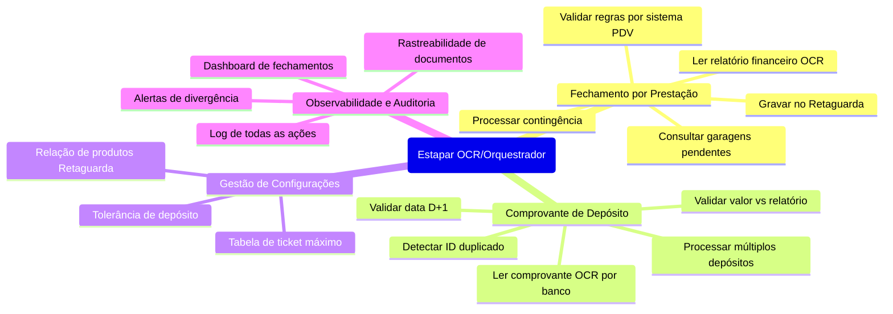
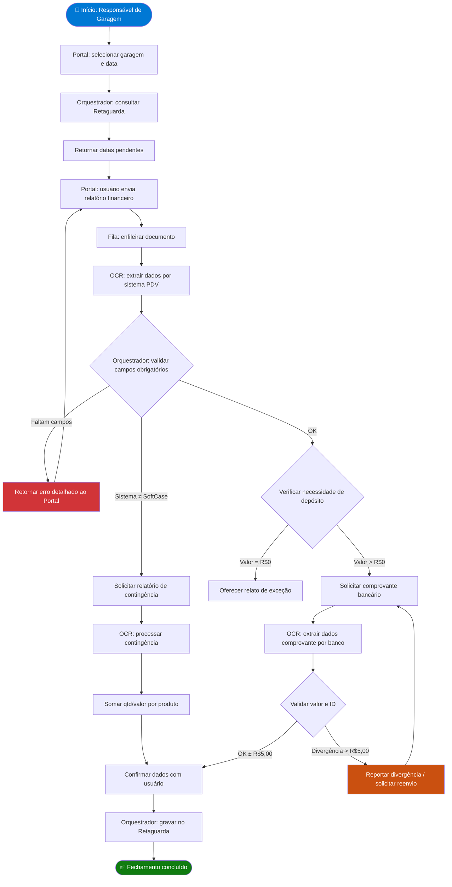
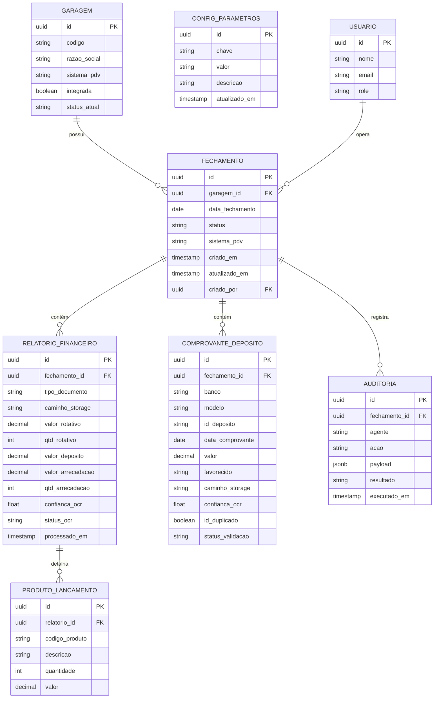
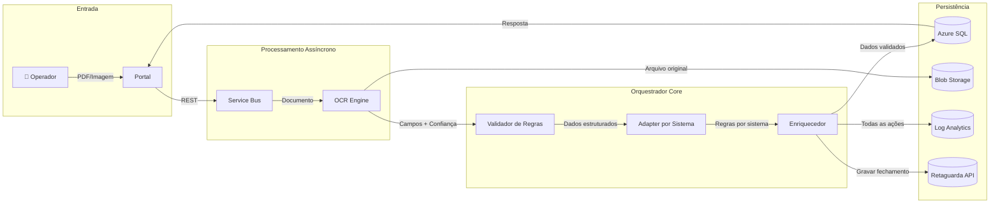
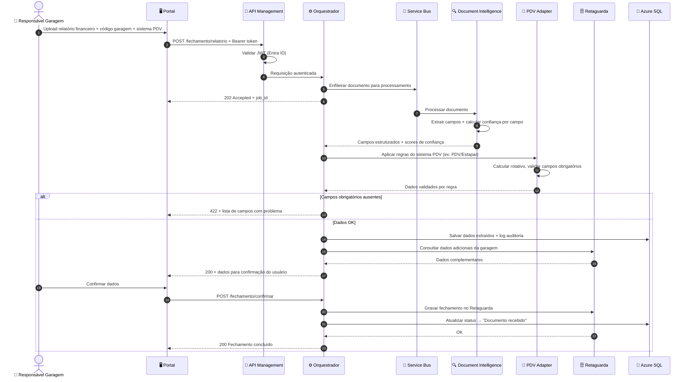
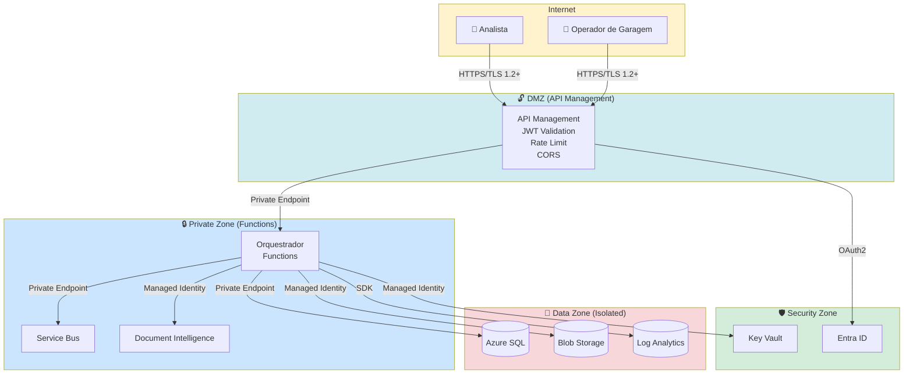
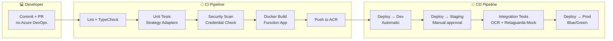
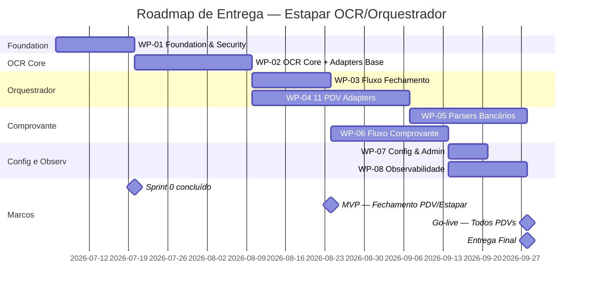
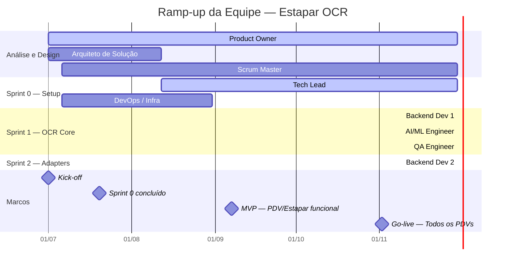
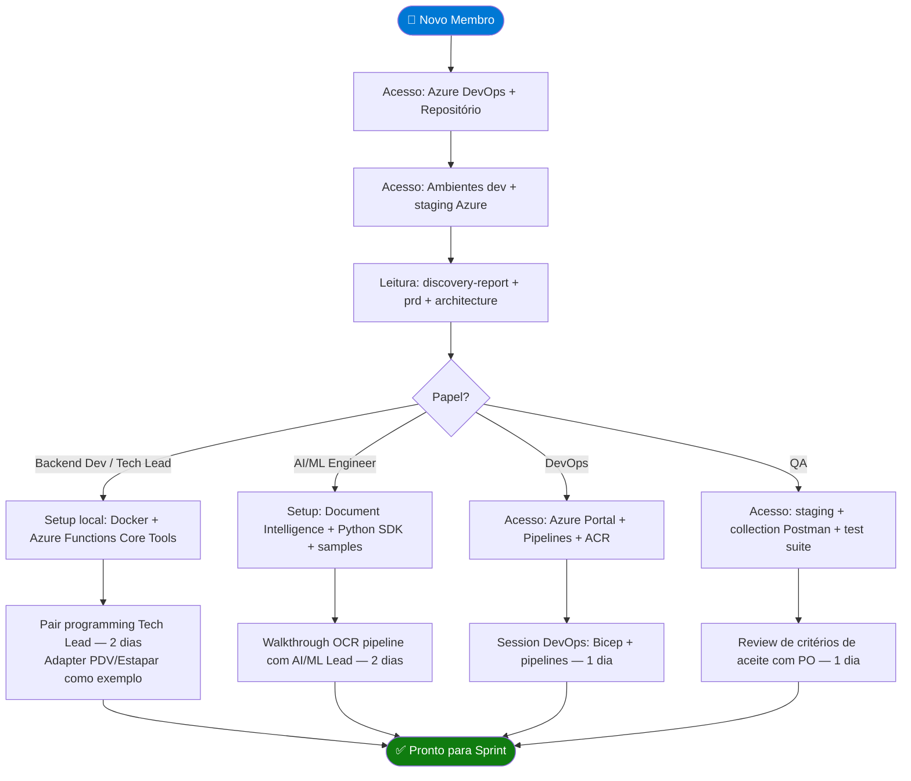

# Architecture — Estapar OCR/Orquestrador — Fechamento de Caixa

**Versão:** 1.0  
**Data:** 2026-05-31  
**Autor:** @architect (Aria)  
**Metodologia:** TOGAF 10 — ADM Phases A–E  
**PRD:** [prd.md](prd.md)  
**Status:** Draft

---

## Phase A — Architecture Vision

### A.1 Declaração de Problema de Negócio

**Capacidade atual (As-Is):** Fechamento de prestação diária realizado manualmente — operadores enviam relatórios em PDF/imagem de 11 sistemas PDV distintos, analistas validam e digitam dados no Retaguarda.

**Capacidade alvo (To-Be):** OCR extrai dados automaticamente de qualquer layout, orquestrador aplica regras de negócio por sistema e valida comprovantes bancários de 9+ tipos, gravando no Retaguarda sem intervenção humana na operação padrão.

**Gap:** Falta de camada inteligente de extração (OCR) e orquestração (regras por sistema) entre o Portal e o Retaguarda.

### A.2 Princípios Arquiteturais

| # | Princípio | Implicação |
|---|-----------|-----------|
| PA-01 | Security by Design | TLS 1.2+, auth dois fatores Portal↔Orquestrador, AES-256 em repouso desde o MVP |
| PA-02 | Observability First | Logs estruturados + métricas em cada step do pipeline; alerta < 5 min em falha crítica |
| PA-03 | Extensibility by Adapter | Novo PDV ou banco = novo adapter, sem tocar no core do orquestrador |
| PA-04 | Async Processing | Processamento OCR em fila — evita timeout e garante resiliência (max 3 retries) |
| PA-05 | Configuration over Code | Tolerância R$5,00 e tabela de ticket máximo configuráveis via admin sem deploy |
| PA-06 | Audit Everything | 100% das ações com timestamp, usuário/sistema, resultado — retenção 90 dias |

### A.3 Stakeholder Architecture Concerns

| Stakeholder | Preocupação | Como a arquitetura endereça |
|-------------|------------|---------------------------|
| Alcir Oliveira / Flavio Abade | ROI e confiabilidade operacional | Pipeline assíncrono com retry; precisão OCR ≥ 90% por campo |
| Flavio Ramalho | Integração com Retaguarda legado | Adapter pattern isola Retaguarda — mudanças na API não afetam o core |
| Livia Cordeiro | Fidelidade às regras de negócio | Strategy pattern por sistema PDV — cada regra é testável isoladamente |
| Analista de Fechamento | Visibilidade de exceções | App Insights + Dashboard de processamento; alertas automáticos |
| Responsável de Garagem | Feedback rápido sobre erros | Response em ≤ 30s com descrição detalhada do campo com problema |

### A.4 Diagrama de Contexto (C4 Level 1)

### A.5 Classificação de Complexidade

| Dimensão | Score (1-5) | Justificativa |
|----------|------------|--------------|
| Escopo | 4 | 32 FRs, 11 sistemas PDV, 9+ bancos |
| Integração | 3 | 2 sistemas externos (Portal + Retaguarda) + OCR Engine |
| Infraestrutura | 3 | Cloud Azure, filas, storage temporário — sem on-premise novo |
| Conhecimento | 3 | OCR como serviço gerenciado; regras de negócio detalhadas na spec |
| Risco | 4 | Pendências P1-P4 não resolvidas; diversidade de layouts |
| **Total** | **17/25** | |

**Classe:** STANDARD  
**Estilo recomendado:** Monolito Modular (orquestrador único com módulos independentes por domínio)

---

### A.6 Legenda de Componentes Azure

#### Camada de Entrada e Processamento

|  **API Management** |  **Orquestrador (Functions)** |  **OCR (Cognitive Services)** |  **Service Bus (Fila)** |
|:---:|:---:|:---:|:---:|
| `azure:api-management` | `azure:functions` | `azure:cognitive-services` | `azure:service-bus` |

#### Camada de Dados e Segurança

|  **SQL Database (Audit/Config)** |  **Blob Storage (Docs)** |  **Key Vault** |  **Entra ID** |
|:---:|:---:|:---:|:---:|
| `azure:sql-database` | `azure:storage-accounts` | `azure:key-vault` | `azure:azure-active-directory` |

#### Observabilidade e DevOps

|  **Azure Monitor** |  **App Insights** |  **Azure DevOps** |  **Container Registry** |
|:---:|:---:|:---:|:---:|
| `azure:monitor` | `azure:application-insights` | `azure:devops` | `azure:container-registry` |

---

## Phase B — Business Architecture

### B.1 Mapa de Capacidades de Negócio

### B.2 Fluxo de Processo — To-Be

### B.3 Matriz Ator × Capacidade

| Capacidade | Responsável de Garagem | Analista de Fechamento | Portal (Sistema) | Orquestrador (Sistema) |
|-----------|:---:|:---:|:---:|:---:|
| Consultar garagens pendentes | — | Leitura | CRUD | Executa |
| Enviar relatório financeiro | CRUD | — | Repasse | Recebe |
| Extrair dados OCR | — | — | — | Executa |
| Validar regras negócio | — | Revisão exceções | — | Executa |
| Enviar comprovante | CRUD | — | Repasse | Recebe |
| Confirmar dados extraídos | Confirmação | — | Interface | — |
| Gravar no Retaguarda | — | — | — | Executa |
| Configurar parâmetros | — | Leitura | — | Admin |

---

## Phase C — Information Systems Architecture

### C1 — Data Architecture

#### C1.1 Diagrama ER Conceitual

#### C1.2 Estratégia de Armazenamento

| Tipo de Dado | Tecnologia | Justificativa | NFR coberto |
|-------------|-----------|--------------|------------|
| Dados transacionais (fechamentos, relatórios, comprovantes) | Azure SQL Database | ACID, relacionamentos, Row-Level Security | NFR-08 |
| Documentos originais (PDFs, imagens) | Azure Blob Storage | Custo-benefício, retenção configurável, CDN | NFR-06 |
| Parâmetros de configuração | Azure SQL + Key Vault (secrets) | Configurável sem deploy; segredos criptografados | NFR-05/12 |
| Logs de auditoria e telemetria | Azure Log Analytics | Retenção 90 dias, consultas analíticas | NFR-07 |
| Tokens de autenticação | Entra ID / Key Vault | Gerenciado, expiração automática | NFR-04 |

#### C1.3 Política de Dados Pessoais (LGPD)

| Dado Pessoal | Onde Armazenado | Criptografado | Retenção | Exclusão |
|-------------|----------------|--------------|---------|---------|
| Razão social da garagem | SQL Database | Em repouso (AES-256) | Enquanto garagem ativa | Soft delete + anonimização |
| Dados bancários (favorecido, ID depósito) | SQL Database | Em repouso (AES-256) | 90 dias após fechamento | Purge automático |
| Documentos originais (PDF/imagem) | Blob Storage | Em repouso (AES-256) | ≤ 24h após processamento | Exclusão automática por lifecycle policy |
| Logs de auditoria | Log Analytics | Em repouso | 90 dias | Purge automático |

#### C1.4 Fluxo de Dados Principais

---

### C2 — Application Architecture

#### C2.1 Catálogo de Componentes

| Componente | Responsabilidade | Tecnologia | Expõe | Consome |
|-----------|-----------------|-----------|-------|---------|
| Portal Estapar | Interface do usuário, upload de documentos | Existente (fora de escopo) | — | API Orquestrador |
| API Gateway | Autenticação, rate limit, roteamento | Azure API Management | REST | Orquestrador Functions |
| Orquestrador (core) | Fluxo de processamento, regras de negócio | Azure Functions (C# / Node.js) | REST | OCR, Retaguarda, SQL, Service Bus |
| OCR Engine | Extração de texto e campos estruturados | Azure Document Intelligence | REST | Blob Storage |
| PDV Adapter (×11) | Regras de cálculo por sistema PDV | Módulo interno do Orquestrador | — | OCR output |
| Bank Parser (×9+) | Extração de ID/valor por banco/modelo | Módulo interno do Orquestrador | — | OCR output |
| Config Service | Parâmetros configuráveis (ticket, tolerância) | Azure SQL + Key Vault | REST interno | — |
| Retaguarda Client | Adapter para API legada do Retaguarda | Módulo do Orquestrador | — | Retaguarda REST |
| Audit Logger | Log estruturado de todas as ações | App Insights + Log Analytics | — | Todos os componentes |
| Document Store | Armazenamento temporário de documentos | Azure Blob Storage | REST | OCR, Orquestrador |

#### C2.2 Diagrama de Container (C4 Level 2)

#### C2.3 Diagrama de Sequência — Fluxo Principal (Relatório Financeiro)

---

## Phase D — Technology Architecture

### D.1 Stack Tecnológica

| Camada | Tecnologia | Justificativa |
|--------|-----------|--------------|
| Frontend/Portal | Existente (fora de escopo) | — |
| API Gateway | Azure API Management | Rate limit, JWT validation, CORS, logging |
| Orquestrador | Azure Functions (Consumption/Premium) | Serverless, escala automática, trigger por Service Bus |
| OCR Engine | Azure Document Intelligence | Modelos pré-treinados para documentos financeiros; Custom Model para layouts específicos |
| Fila | Azure Service Bus (Standard) | Ordenação garantida, DLQ, retry automático |
| Banco de dados | Azure SQL Database (General Purpose) | ACID, RLS, backup automático |
| Document Storage | Azure Blob Storage (Hot → Cool lifecycle) | Hot por 24h → Cool → Expiração automática |
| Auth | Azure Entra ID | JWT, OAuth2, auth dois fatores |
| Secrets | Azure Key Vault | Conexão Retaguarda, chaves de criptografia |
| Observabilidade | Azure Monitor + Application Insights | Traces, métricas, alertas, dashboards |
| Log de auditoria | Azure Log Analytics | Retenção 90 dias, queries KQL |
| CI/CD | Azure DevOps Pipelines | Build, test, deploy multi-ambiente |
| IaC | Bicep / Terraform | Infraestrutura como código |
| Container Registry | Azure Container Registry | Imagens Docker dos Function Apps |

### D.2 Diagrama de Tecnologia (Infraestrutura)

### D.3 Padrões de Rede e Segurança

### D.4 Estratégia CI/CD

### D.5 Observabilidade

| Pilar | Ferramenta | O que monitora |
|-------|-----------|---------------|
| Logs estruturados | Application Insights | Cada step do pipeline com job_id, garagem, sistema, resultado |
| Métricas de negócio | Azure Monitor Workbooks | Fechamentos/dia, taxa de erro OCR, tempo médio por sistema PDV |
| Auditoria | Log Analytics (KQL) | 100% das ações com timestamp e agente |
| Alertas | Azure Monitor Alerts | Falha em processamento, fila parada, latência > 30s |
| Dashboard | Azure Workbooks | Status por garagem, fechamentos pendentes, erros por banco |
| Distributed Tracing | App Insights — correlation_id | Rastreamento E2E: Portal → APIM → Function → OCR → Retaguarda |

---

## Phase E — Opportunities & Solutions

### E.1 Work Packages

| WP | Nome | Fase TOGAF | Componentes | Sprint |
|----|------|-----------|------------|--------|
| WP-01 | Foundation: Infrastructure & Security | D | APIM, Entra ID, Key Vault, Service Bus, Blob, SQL schema, CI/CD | S1 |
| WP-02 | OCR Core: Extração Base | C2 | Document Intelligence, PDV Adapters base, Bank Parsers base | S1–S2 |
| WP-03 | Orquestrador: Fluxo de Fechamento | C2+B | Validação campos, integração Retaguarda, gravação, auditoria | S2 |
| WP-04 | OCR: Adapters PDV (11 sistemas) | C2 | Um adapter por sistema PDV com testes unitários | S2–S3 |
| WP-05 | OCR: Parsers Bancários (9+ tipos) | C2 | Um parser por banco/modelo com testes | S3 |
| WP-06 | Orquestrador: Fluxo de Comprovante | C2+B | Validação depósito, ID duplicado, D+1, múltiplos | S3–S4 |
| WP-07 | Config & Admin | C2 | Config Service, tabela de ticket máximo, tolerância configurável | S4 |
| WP-08 | Observabilidade e Dashboard | D | App Insights, Workbooks, Alertas | S4 |

### E.2 Sequência de Entrega

### E.3 Build vs Buy vs Integrate

| Componente | Decisão | Produto/Serviço | Justificativa |
|-----------|---------|----------------|--------------|
| OCR Engine | Integrate | Azure Document Intelligence | Modelos pré-treinados; Custom Model para layouts específicos; sem custo de treinamento |
| API Gateway | Integrate | Azure API Management | Rate limit, CORS, auth delegada ao Entra ID |
| Autenticação | Integrate | Azure Entra ID | MFA nativo, OAuth2, SSO corporativo |
| Orquestrador (core) | Build | Azure Functions | Regras de negócio proprietárias — diferenciação |
| PDV Adapters (×11) | Build | Módulos internos | Regras específicas por sistema PDV |
| Bank Parsers (×9+) | Build | Módulos internos | Lógica de ID específica por banco/modelo |
| Fila | Integrate | Azure Service Bus | DLQ, retry, ordenação — sem custom |
| Observabilidade | Integrate | Azure Monitor + App Insights | Nativo na stack Azure |

---

## Phase E — Team Plan

> Estimativa de equipe para construção do sistema OCR/Orquestrador da Estapar.  
> Equipe dimensionada para complexidade STANDARD com 8 work packages.

### E.4 Composição da Equipe

|  **Product Owner** |  **Arquiteto** |  **Tech Lead** |  **Backend Dev** |  **Backend Dev 2** |
|:---:|:---:|:---:|:---:|:---:|
| 1 pessoa | 1 pessoa | 1 pessoa | 1 pessoa | 1 pessoa |
| Full-time | Part-time (50%) | Full-time | Full-time | Full-time |

|  **DevOps/Infra** |  **QA Engineer** |  **AI/ML Engineer** |  **Scrum Master** |
|:---:|:---:|:---:|:---:|
| 1 pessoa | 1 pessoa | 1 pessoa | 1 pessoa (compartilhado) |
| Part-time (50%) | Full-time | Full-time | Part-time (30%) |

**Total: 9 pessoas (7,3 FTEs)**

---

### E.5 Ramp-up da Equipe

---

### E.6 Matriz de Papéis e Responsabilidades (RACI)

> R=Responsável | A=Aprovador | C=Consultado | I=Informado

| Atividade |  PO |  Arquiteto |  Tech Lead |  Backend |  AI/ML |  DevOps |  QA |
|-----------|:---:|:---:|:---:|:---:|:---:|:---:|:---:|
| Discovery / PRD | A | C | C | I | I | I | I |
| Arquitetura e ADRs | C | R | C | C | C | C | I |
| PDV Adapters (×11) | I | C | A | R | C | I | C |
| OCR Pipeline + AI | I | C | A | C | R | I | C |
| Parsers Bancários (×9) | I | C | A | R | C | I | C |
| Integração Retaguarda | I | C | A | R | I | I | C |
| Infra Azure + CI/CD | I | C | A | I | I | R | I |
| Testes e QA | I | I | A | C | C | I | R |
| Deploy e release | A | I | C | I | I | R | C |
| Sprint planning | A | I | R | C | C | I | C |

---

### E.7 Estimativa de Custo de Equipe

> Base para o Business Case. Valores de mercado Brasil 2026 (Pleno/Sênior).

| Papel | Senioridade | Dedicação | Custo/Mês (R$) | Início | Duração | Total (R$) |
|-------|------------|----------|---------------|--------|---------|-----------|
| Product Owner | Sênior | 100% | R$ 18.000 | Semana 1 | 5 meses | R$ 90.000 |
| Arquiteto de Solução | Sênior | 50% | R$ 12.000 | Semana 1 | 6 semanas | R$ 18.000 |
| Tech Lead | Sênior | 100% | R$ 22.000 | Sprint 0 | 4,5 meses | R$ 99.000 |
| Backend Dev 1 | Pleno | 100% | R$ 13.000 | Sprint 1 | 4 meses | R$ 52.000 |
| Backend Dev 2 | Pleno | 100% | R$ 13.000 | Sprint 2 | 3,5 meses | R$ 45.500 |
| AI/ML Engineer | Sênior | 100% | R$ 18.000 | Sprint 1 | 4 meses | R$ 72.000 |
| DevOps / Infra | Pleno | 50% | R$ 7.500 | Sprint 0 | 4 meses | R$ 30.000 |
| QA Engineer | Pleno | 100% | R$ 10.000 | Sprint 1 | 4 meses | R$ 40.000 |
| Scrum Master | Sênior | 30% | R$ 4.500 | Sprint 0 | 5 meses | R$ 22.500 |
| **Total mensal (pico Sprint 2)** | | | **R$ 118.000** | | | **R$ 469.000** |

> **Encargos CLT:** multiplicar por 1,7x → pico R$ 200.600/mês | total R$ 797.300  
> **PJ/Freelancer:** sem multiplicador, adicionar 12% de margem de imprevistos  
> **Infraestrutura Azure estimada:** R$ 8.000–15.000/mês (Functions + APIM + SQL + Storage + Document Intelligence)

---

### E.8 Plano de Onboarding

---

### E.9 Canais e Ferramentas de Comunicação

|  **Daily** |  **Sprint** |  **Demo** |  **Tracking** |  **Code** |
|:---:|:---:|:---:|:---:|:---:|
| MS Teams | Azure Boards | Teams / Zoom | Azure Boards (Sprints) | Azure DevOps Repos |
| 15min / dia | 2 semanas | Fim de sprint | Diário | Contínuo |

---

## ADRs — Architecture Decision Records

### ADR-001: Monolito Modular para o Orquestrador
**Status:** Accepted | **Data:** 2026-05-31 | **Fase TOGAF:** Phase A  
**NFRs:** NFR-09, NFR-02, NFR-03

#### Contexto
O orquestrador precisa suportar 11 sistemas PDV e 9+ tipos de comprovante bancário, cada um com regras próprias. A equipe tem 9 pessoas e o prazo é ~5 meses.

#### Decisão
Monolito Modular com Azure Functions — um único Function App com módulos internos independentes (adapters/strategies por sistema).

#### Alternativas Consideradas
| Alternativa | Por que rejeitada |
|-------------|------------------|
| Microservices (1 serviço por PDV) | Overhead operacional de 11+ serviços para equipe de 9 pessoas; latência de comunicação; complexidade de orquestração desproporcional |
| Serverless puro sem orquestração | Sem estado transacional entre steps; difícil rastrear auditoria E2E do pipeline |

#### Consequências
- ✅ Time-to-market menor; deploy único; debugging mais simples
- ✅ Adapter pattern mantém extensibilidade (NFR-09: novo PDV ≤ 5 dias)
- ⚠️ Deploy completo ao adicionar novo adapter — mitigado por testes isolados por módulo
- ⚠️ Potencial bottleneck se volume crescer muito — mitigado por fila Service Bus e escala horizontal do Functions

#### Revisão
Reavaliar para microservices se equipe crescer para > 20 devs ou volume ultrapassar 10.000 fechamentos/dia.

---

### ADR-002: Azure Document Intelligence como OCR Engine
**Status:** Accepted | **Data:** 2026-05-31 | **Fase TOGAF:** Phase C2  
**NFRs:** NFR-01, NFR-02, NFR-09

#### Contexto
O sistema precisa extrair dados de 11 layouts de relatório PDV e 9+ layouts de comprovante bancário, com confiança ≥ 90% por campo e ≤ 30s de processamento.

#### Decisão
Azure Document Intelligence (Form Recognizer) — modelos pré-treinados para documentos financeiros + Custom Models treinados para os layouts específicos da Estapar.

#### Alternativas Consideradas
| Alternativa | Por que rejeitada |
|-------------|------------------|
| Tesseract (open source) | Precisão inferior em documentos complexos; sem nível de confiança por campo; custo de manutenção alto |
| Google Document AI | Vendor lock-in fora do ecossistema Azure já adotado; custo de egress de dados |

#### Consequências
- ✅ Modelos pré-treinados aceleram o MVP; Custom Model para layouts únicos
- ✅ Confiança por campo nativa — viabiliza NFR-01
- ⚠️ Custo por página processada — mitigado por armazenamento temporário ≤ 24h
- ⚠️ Requer treinamento de Custom Model para cada novo layout — planejado como WP-02

#### Revisão
Reavaliar se precisão dos Custom Models cair abaixo de 88% após 3 meses de operação.

---

### ADR-003: Azure Entra ID para Autenticação
**Status:** Accepted | **Data:** 2026-05-31 | **Fase TOGAF:** Phase D  
**NFRs:** NFR-04, NFR-05

#### Contexto
O sistema exige autenticação em dois fatores entre Portal e Orquestrador (RN03), tokens com expiração ≤ 1h e integração com identidade corporativa da Estapar.

#### Decisão
Azure Entra ID com OAuth2/JWT — token Bearer validado no API Management antes de qualquer requisição ao Orquestrador.

#### Alternativas Consideradas
| Alternativa | Por que rejeitada |
|-------------|------------------|
| Auth JWT própria | Risco de segurança alto; sem MFA nativo; manutenção de chaves |
| Auth0 | Custo adicional fora do ecossistema Azure; ausência de SSO corporativo nativo |

#### Consequências
- ✅ MFA nativo, Conditional Access, compliance Microsoft
- ✅ Managed Identity para comunicação entre Function e outros serviços Azure (sem credenciais em código)
- ⚠️ Curva de aprendizado do SDK — mitigado pelo AI/ML + Tech Lead já familiarizados com Azure

#### Revisão
Permanente — critério de segurança não negocia.

---

## Riscos Técnicos

| # | Risco | Probabilidade | Impacto | Severidade | Mitigação | Contingência |
|---|-------|--------------|---------|-----------|----------|-------------|
| RT-01 | Layouts de banco/PDV não mapeados (novos modelos) | Alta | Alto | CRÍTICO | Treinar OCR com exemplos reais de cada sistema antes do sprint | Entrada manual como fallback por sistema |
| RT-02 | API do Retaguarda sem endpoints necessários | Média | Alto | CRÍTICO | Mapear endpoints existentes no Sprint 0; criar mock para testes | API intermediária/adapter para Retaguarda legada |
| RT-03 | Itens pendentes P1-P4 não resolvidos antes do Sprint 1 | Alta | Médio | ALTO | Escalar com aprovadores; usar valores placeholder configuráveis | Implementar com config externa; resolver em S2 |
| RT-04 | Confiança OCR < 90% em layouts de fita (baixa resolução) | Média | Alto | ALTO | Definir resolução mínima de upload; testar com amostras reais | Fluxo de revisão manual para documentos abaixo do limiar |
| RT-05 | Concatenação de ID bancário (Santander M2, Bradesco) com edge cases | Baixa | Médio | MÉDIO | Suite de testes unitários com exemplos reais por banco | Log do ID original para revisão manual |

---

## Cobertura de NFRs

| NFR | Descrição | Solução Arquitetural | Fase TOGAF | ADR |
|-----|-----------|---------------------|-----------|-----|
| NFR-01 | Precisão OCR ≥ 90% | Document Intelligence Custom Models + score por campo | C2 | ADR-002 |
| NFR-02 | ≤ 30s relatório; ≤ 15s comprovante | Processamento assíncrono via Service Bus | C2 | ADR-001 |
| NFR-03 | Disponibilidade ≥ 99,5% | Azure Functions Premium + Service Bus DLQ + retry | D | — |
| NFR-04 | Auth dois fatores | Entra ID + APIM JWT validation | D | ADR-003 |
| NFR-05 | TLS 1.2+ | Azure API Management + Private Endpoints | D | ADR-003 |
| NFR-06 | AES-256 + retenção ≤ 24h | Blob Storage encryption + Lifecycle Policy | C1+D | — |
| NFR-07 | Auditoria 100% | App Insights structured logging + Log Analytics | D | — |
| NFR-08 | LGPD | RLS no SQL, criptografia repouso, soft delete, lifecycle | C1 | ADR-002 |
| NFR-09 | Novo layout ≤ 5 dias | Adapter/Strategy pattern por PDV/banco | C2 | ADR-001 |
| NFR-10 | Reprocessamento automático | Service Bus DLQ + retry 3x + dead-letter queue | D | — |
| NFR-11 | Alertas < 5 min | Azure Monitor Alerts + App Insights | D | — |
| NFR-12 | Parâmetros configuráveis | Config Service + Key Vault; sem deploy para tolerância/ticket | C2 | — |
| NFR-13 | ≥ 500 fechamentos simultâneos | Functions Consumption Plan auto-scale + Service Bus partitioning | D | ADR-001 |

---

## Histórico de Versões

| Versão | Data | Autor | Mudança |
|--------|------|-------|---------|
| 1.0 | 2026-05-31 | @architect (Aria) | Versão inicial — TOGAF ADM Phases A–E |
