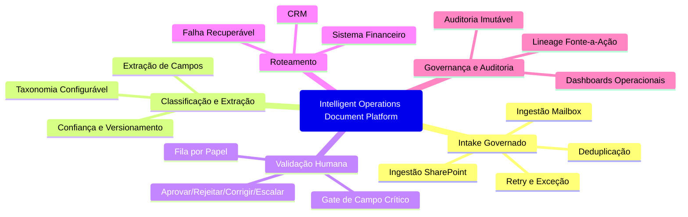
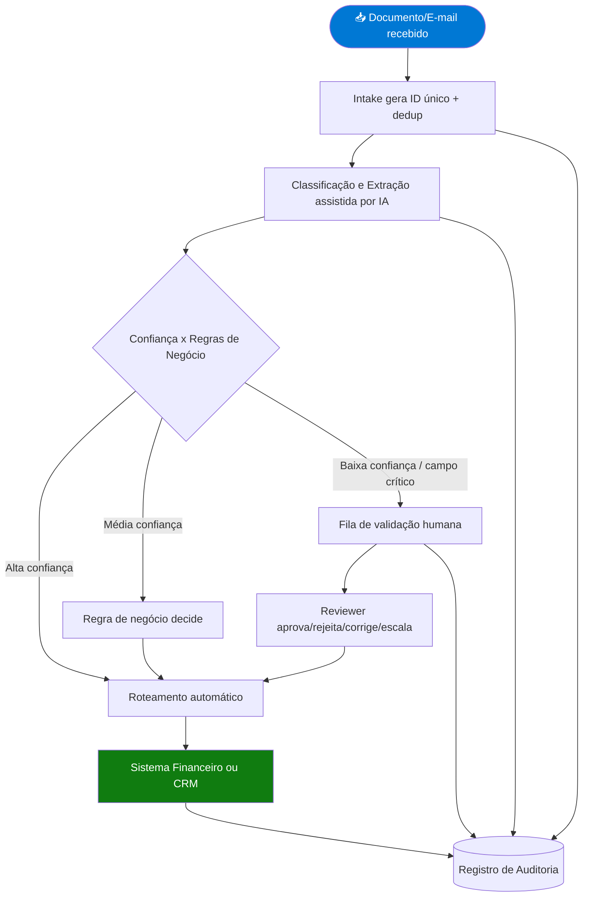
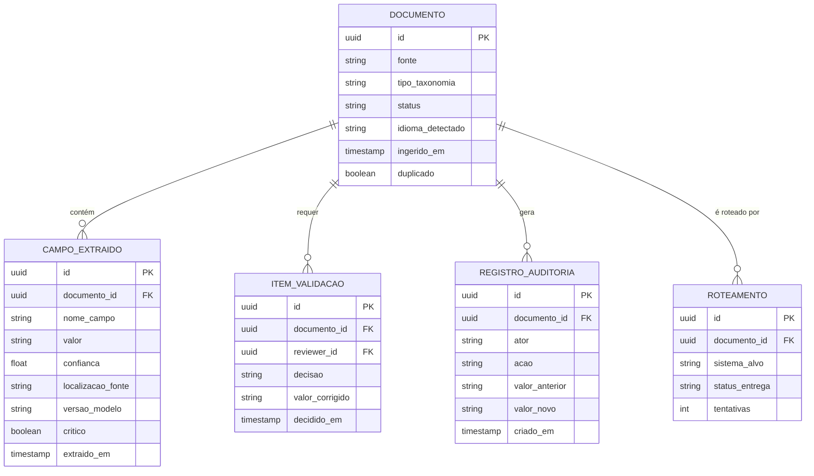
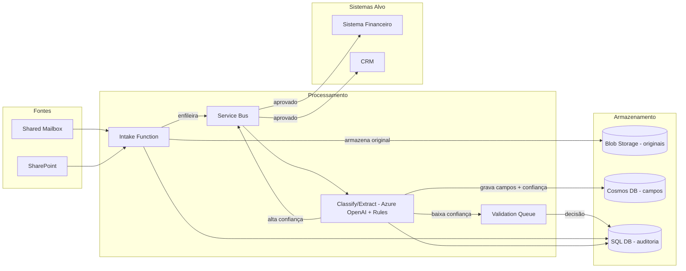
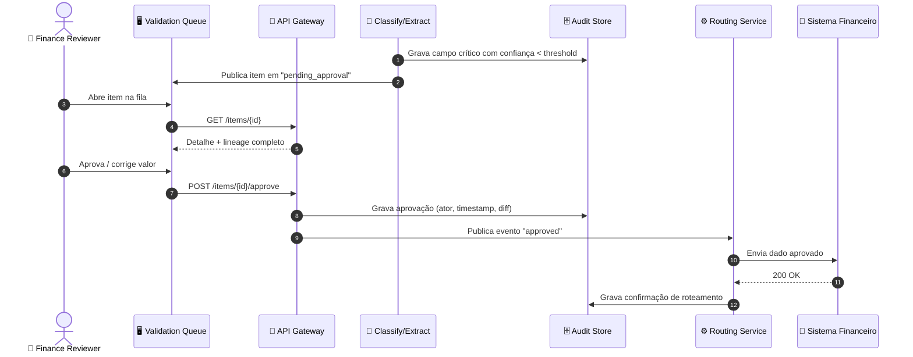
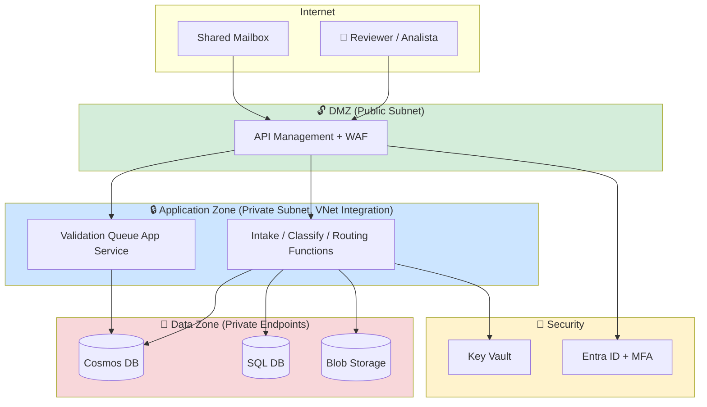
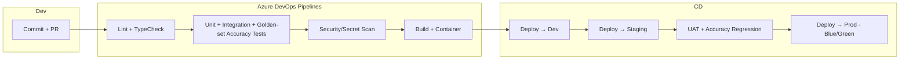
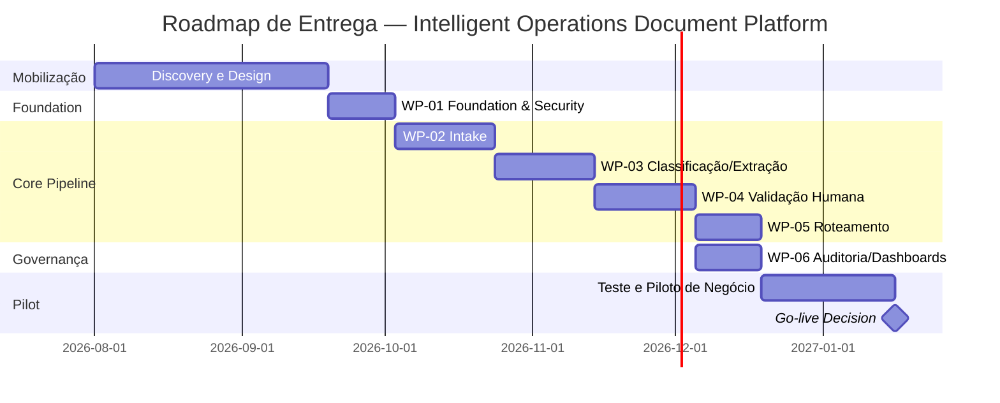
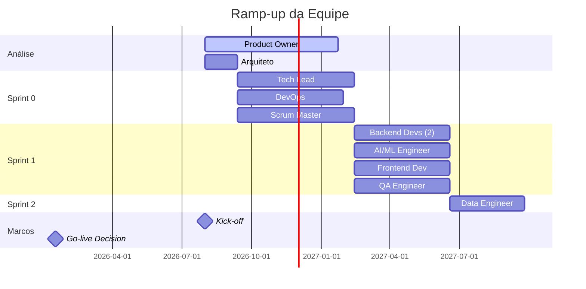
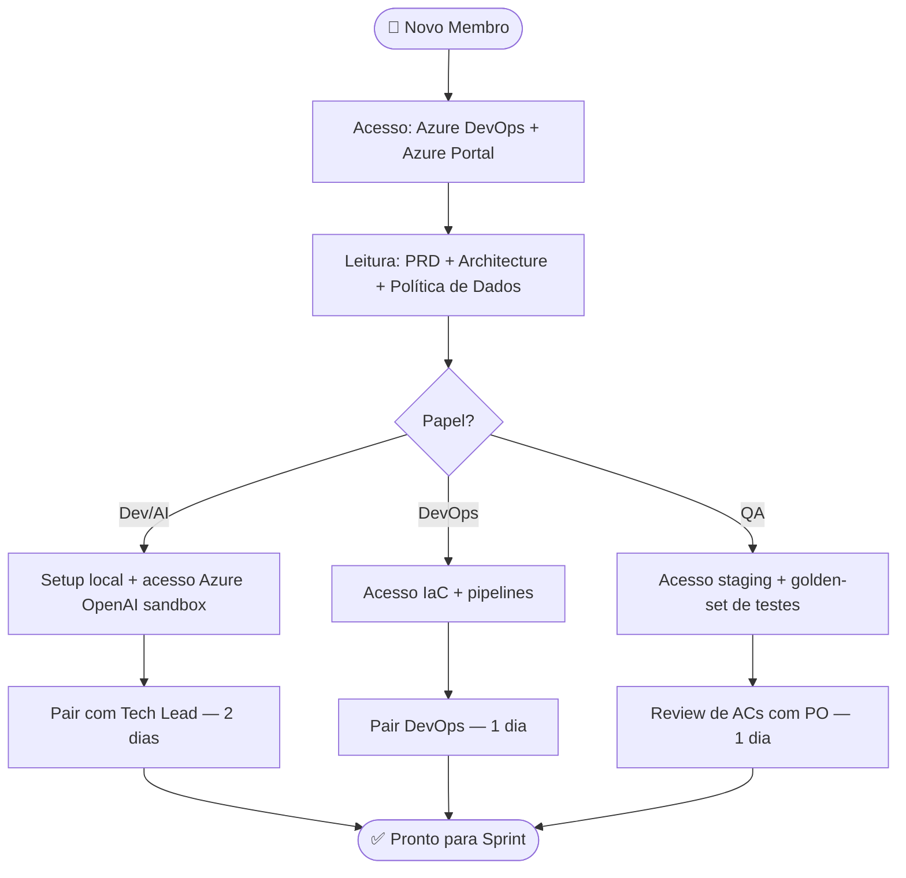

# Architecture — Intelligent Operations Document Platform

**Versão:** 1.0
**Data:** 2026-07-19
**Autor:** @architect (Aria)
**Metodologia:** TOGAF 10 — ADM Phases A–E
**PRD:** [prd.md](prd.md)
**Status:** Draft

---

## Phase A — Architecture Vision

### A.1 Declaração de Problema de Negócio

**Capacidade atual (As-Is):** triagem, classificação e extração manuais de documentos operacionais, sem confiança calculada nem gate de aprovação obrigatório para dado crítico.
**Capacidade alvo (To-Be):** pipeline governado de intake → classificação/extração assistida por IA → confiança calibrada → validação humana obrigatória para itens críticos → roteamento automático → auditoria completa.
**Gap:** ausência de orquestração de documentos com proveniência ponta a ponta e de um gate de governança que impeça decisão material baseada em IA não revisada (FR-012, RQ-005).

### A.2 Princípios Arquiteturais

| # | Princípio | Implicação |
|---|-----------|------------|
| PA-01 | Human-in-the-loop obrigatório para dado crítico | Nenhum roteamento automático de campo crítico sem aprovação (FR-012) |
| PA-02 | Proveniência total (source-to-action) | Todo campo extraído carrega origem, confiança, versão de modelo (FR-008, FR-010) |
| PA-03 | Observability & Auditability First | Logs, métricas, traces e auditoria imutável desde o Sprint 1 |
| PA-04 | API-First e contratos versionados | Integrações com finance/CRM/mailbox via contrato explícito antes de implementar |
| PA-05 | Configuração > Código para extensibilidade | Novos tipos de documento via taxonomia/config, não redeploy (FR-021) |
| PA-06 | Privacy & Data Minimization by Design | Redação de PII em log por padrão, retenção configurável (NFR-009) |

### A.3 Stakeholder Architecture Concerns

| Stakeholder | Preocupação | Como a arquitetura endereça |
|-------------|-------------|-------------------------------|
| COO | Valor de negócio e adoção | Dashboards operacionais (FR-018) + métricas de sucesso mensuráveis |
| Finance/Customer Ops Director | Precisão e throughput | Fila de validação priorizada por confiança + SLA de 60s p95 (NFR-003) |
| Enterprise Architect | Padrões e reuso | Componentização por domínio (intake/classify/extract/review/route) reutilizável para novos tipos de doc |
| DPO | Minimização e retenção | Política de dados pessoais por categoria (C1.4) + Key Vault + redação de log |
| InfoSec Lead | Identidade, secrets, rede | Entra ID + MFA + Key Vault + rede isolada (Phase D) |
| Platform Engineering | Suportabilidade | Observabilidade completa + runbook de operação (Phase D.4) |

### A.4 Diagrama de Contexto (C4 Level 1)

### A.5 Classificação de Complexidade

| Dimensão | Score (1-5) | Justificativa |
|----------|:---:|--------------|
| Escopo | 4 | 9+ componentes (intake, classificação, extração, confiança, fila, roteamento x2, auditoria, dashboards) |
| Integração | 4 | Mailbox, SharePoint, sistema financeiro, CRM, IdP corporativo — 4+ integrações críticas |
| Infraestrutura | 3 | Cloud gerenciado com múltiplos serviços orquestrados (não K8s multi-cloud) |
| Conhecimento | 3 | Stack Azure conhecida, mas governança de IA generativa é parcialmente nova para a equipe |
| Risco | 5 | Dados financeiros e pessoais, decisão de negócio material, exigência regulatória de auditoria |
| **Total** | **19/25** | |

**Classe:** COMPLEX
**Estilo recomendado:** Event-Driven com orquestração assíncrona (mensageria entre intake → classificação → fila → roteamento), não monolito nem microserviços completos — um **modular event-driven** com serviços por domínio.

---

### A.6 Legenda de Componentes Azure

| Componente | Ícone Azure de referência |
|-----------|---------------------------|
| API Management | `azure/devops/10042-icon-service-API-Management-Services.svg` |
| Functions (Intake/Orquestração) | `azure/compute/10029-icon-service-Function-Apps.svg` |
| Azure OpenAI (Classificação/Extração) | `azure/learning/03438-icon-service-Azure-OpenAI-Service.svg` |
| App Service (Validation Queue UI) | `azure/compute/10035-icon-service-App-Services.svg` |
| SQL Database (Audit/Provenance) | `azure/databases/10130-icon-service-SQL-Database.svg` |
| Cosmos DB (metadados de documento) | `azure/databases/10121-icon-service-Azure-Cosmos-DB.svg` |
| Blob Storage (documentos originais) | `azure/storage/10086-icon-service-Storage-Accounts.svg` |
| Service Bus (fila intake→classify→route) | `azure/integration/10836-icon-service-Service-Bus.svg` |
| Entra ID | `azure/identity/10230-icon-service-Azure-Active-Directory.svg` |
| Key Vault | `azure/security/10245-icon-service-Key-Vaults.svg` |
| Monitor + App Insights | `azure/monitor/00001-icon-service-Monitor.svg`, `azure/devops/00012-icon-service-Application-Insights.svg` |
| Azure DevOps | `azure/devops/10261-icon-service-Azure-DevOps.svg` |

> Catálogo completo: [`assets/icons/azure/AZURE-ICONS.md`](../../../assets/icons/azure/AZURE-ICONS.md)

---

## Phase B — Business Architecture

### B.1 Mapa de Capacidades de Negócio

### B.2 Fluxo de Processo — To-Be

### B.3 Matriz Ator × Capacidade

| Capacidade | Finance Reviewer | Customer Service Analyst | Platform Engineering | DPO/Compliance |
|-----------|:---:|:---:|:---:|:---:|
| Fila de validação | CRUD | CRUD | Leitura | Leitura |
| Configuração de taxonomia | — | — | CRUD | Consulta |
| Dashboards operacionais | Leitura | Leitura | CRUD | Leitura |
| Auditoria e lineage | Leitura | Leitura | Leitura | CRUD (política) |

---

## Phase C — Information Systems Architecture

### C1 — Data Architecture

#### C1.1 Diagrama ER Conceitual

#### C1.2 Estratégia de Armazenamento

| Tipo de Dado | Tecnologia | Justificativa | NFR coberto |
|-------------|-----------|--------------|-------------|
| Documento original (PDF/imagem/e-mail) | Azure Blob Storage (imutável, versionado) | Custo-benefício, retenção configurável | NFR-004, NFR-009 |
| Metadados de documento e campos extraídos | Azure Cosmos DB | Schema semiestruturado, alto volume, baixa latência de leitura | NFR-003, NFR-004 |
| Auditoria e proveniência | Azure SQL Database (append-only, RLS) | ACID + integridade referencial para lineage 100% (NFR-010) | NFR-010 |
| Fila de eventos intake→classify→route | Azure Service Bus | Garantia de entrega, retry, dead-letter queue | FR-004, FR-015 |
| Cache de sessão/fila | Azure Cache for Redis | Latência de fila ≤ 3s p95 | NFR-002 |
| Logs de diagnóstico | Azure Log Analytics (com redação de PII) | Retenção configurável, sem PII por padrão | NFR-009, NFR-013 |

#### C1.3 Fluxo de Dados Principais

#### C1.4 Política de Dados Pessoais (Privacidade / DPO)

| Dado Pessoal | Onde Armazenado | Criptografado | Retenção | Exclusão |
|-------------|-----------------|---------------|----------|----------|
| Dados de fatura/pagamento (nome, conta) | Cosmos DB + Blob | Em repouso (AES-256) + TLS em trânsito | Configurável por tipo de documento (definir em Discovery detalhado, §12 RFP) | Exclusão lógica + purga programada |
| Anexos de solicitação de cliente (PII) | Blob Storage | Em repouso | Conforme política de retenção acordada | Exclusão sob solicitação (DSAR) |
| Logs de diagnóstico | Log Analytics | Em repouso | 90 dias, sem PII por padrão (redação automática) | Purge automático |
| Registro de auditoria | SQL Database | Em repouso | Retenção estendida (compliance) — nunca deletado, apenas arquivado | Não aplicável (append-only) |

> Residência de dados UK/UE-EEA a confirmar por região Azure na Discovery detalhada (questão aberta #5 e #6 do RFP).

---

### C2 — Application Architecture

#### C2.1 Catálogo de Componentes

| Componente | Responsabilidade | Tecnologia | Expõe | Consome |
|-----------|-------------------|-----------|-------|---------|
| Intake Orchestration | Ingestão, dedup, ID único, retry | Azure Functions | Eventos Service Bus | Mailbox/SharePoint connectors |
| Classification & Extraction | Classificar taxonomia + extrair campos + confiança | Azure OpenAI + regras determinísticas | Eventos processados | Blob, Service Bus |
| Validation Work Queue | UI e API de fila de revisão por papel | App Service (Web + API) | REST | Cosmos DB, SQL |
| Routing Service | Entrega a sistema financeiro/CRM com retry | Azure Functions | Conectores de saída | Service Bus |
| Audit & Provenance Store | Registro imutável de toda ação material | Azure SQL (append-only) | API de consulta | Todos os componentes |
| Dashboards & Metrics | Métricas operacionais e exportação | Power BI / Azure Workbooks | Read API | Cosmos DB, SQL |
| Auth Service | SSO/MFA/RBAC | Entra ID | OAuth2/OIDC | — |

#### C2.2 Diagrama de Container (C4 Level 2)

#### C2.3 Diagrama de Sequência — Validação de Campo Crítico

---

## Phase D — Technology Architecture

### D.1 Diagrama de Tecnologia

### D.2 Padrões de Rede e Segurança

### D.3 Estratégia CI/CD

### D.4 Observabilidade

| Pilar | Ferramenta | O que monitora |
|-------|-----------|-----------------|
| Logs | Azure Log Analytics (com redação de PII) | Erros, ações de auditoria, acesso |
| Métricas | Azure Monitor | Latência de fila, throughput de documentos, taxa de exceção |
| Traces | Application Insights | Rastreamento E2E de um documento (intake → roteamento) |
| Alertas | Azure Monitor Alerts | Violação de SLA (NFR-001/002/003), spike de exceções, falha de roteamento |
| Dashboard | Power BI / Workbooks | KPIs de FR-018: volume, latência, acurácia, exceções, ageing |

---

## Phase E — Opportunities & Solutions

### E.1 Work Packages

| WP | Nome | Fase TOGAF | Componentes | Sprint |
|----|------|-----------|--------------|--------|
| WP-01 | Foundation & Security | D | APIM, Entra ID, Key Vault, ambientes dev/test/prod, CI/CD | S1 |
| WP-02 | Intake Governado | C2 | Intake Function, dedup, retry, fila de exceção | S1-S2 |
| WP-03 | Classificação e Extração | C2 | Azure OpenAI, taxonomia, confiança, versionamento | S2-S3 |
| WP-04 | Validação Humana e Gate Crítico | C2 | Validation Queue, gate de aprovação (FR-012) | S3-S4 |
| WP-05 | Roteamento e Integrações | C2 | Routing Function, conectores finance/CRM | S4-S5 |
| WP-06 | Auditoria, Busca e Dashboards | C1+C2 | Audit Store, busca (FR-016), dashboards (FR-018) | S5-S6 |

### E.2 Sequência de Entrega

### E.3 Build vs Buy vs Integrate

| Componente | Decisão | Ferramenta/Produto | Justificativa |
|-----------|---------|---------------------|----------------|
| Identidade/SSO | Integrate | Entra ID | Compliance e MFA nativos, já corporativo |
| Classificação/Extração de IA | Integrate + Build (camada de regras) | Azure OpenAI + Document Intelligence + regras próprias | Reduz time-to-market mantendo controle do gate de confiança |
| Fila de validação humana | Build | App Service próprio | Diferenciação: workflow de aprovação específico do domínio (FR-012/013) |
| Auditoria/Proveniência | Build | SQL Database append-only próprio | Requisito de auditoria imutável não atendido totalmente por produto de prateleira |
| Dashboards | Buy/Integrate | Power BI | Custo-benefício, sem necessidade de construir BI próprio |

---

## Phase E — Team Plan

### E.4 Composição da Equipe

| Papel | Dedicação | Início |
|-------|-----------|--------|
| Product Owner | Full-time | Semana 1 |
| Arquiteto de Solução | 50% | Semana 1 |
| Tech Lead | Full-time | Semana 3 (Sprint 0) |
| Backend Devs (2) | Full-time | Sprint 1 |
| AI/ML Engineer (classificação/extração) | Full-time | Sprint 1 |
| Frontend Dev (Validation Queue) | Full-time | Sprint 1 |
| DevOps/SRE | 50% | Sprint 0 |
| QA Engineer | Full-time | Sprint 1 |
| Data Engineer | 50% | Sprint 2 |
| Scrum Master | 50% | Sprint 0 |
| DPO/Compliance Advisor | 20% consultivo | Semana 1 |

### E.5 Ramp-up da Equipe

### E.6 Matriz RACI

| Atividade | PO | Arquiteto | Tech Lead | Backend | AI/ML | DevOps | QA | DPO |
|-----------|:---:|:---:|:---:|:---:|:---:|:---:|:---:|:---:|
| Discovery e PRD | A | C | C | I | I | I | I | C |
| Decisões de arquitetura | C | R | C | C | C | C | I | C |
| Gate de confiança/regras de IA | A | C | R | C | R | I | C | C |
| Implementação pipeline | I | C | A | R | R | I | C | I |
| Integrações finance/CRM | A | C | R | R | I | C | C | I |
| Segurança e privacidade | I | C | C | I | I | R | C | A |
| Testes e validação de acurácia | I | I | A | C | R | I | R | C |
| Deploy e release | A | I | C | I | I | R | C | I |

### E.7 Estimativa de Custo de Equipe

| Papel | Dedicação | Custo/Mês (R$) | Duração | Total (R$) |
|-------|-----------|----------------|---------|------------|
| Product Owner | 100% | 18.000 | 6 meses | 108.000 |
| Arquiteto | 50% | 12.000 | 1,5 mês | 9.000 |
| Tech Lead | 100% | 22.000 | 5,5 meses | 121.000 |
| Backend Devs (2) | 100% | 24.000 (par) | 4,5 meses | 108.000 |
| AI/ML Engineer | 100% | 16.000 | 4,5 meses | 72.000 |
| Frontend Dev | 100% | 11.000 | 4,5 meses | 49.500 |
| DevOps/SRE | 50% | 7.000 | 5 meses | 35.000 |
| QA Engineer | 100% | 9.000 | 4,5 meses | 40.500 |
| Data Engineer | 50% | 6.000 | 3,5 meses | 21.000 |
| Scrum Master | 50% | 6.000 | 5,5 meses | 33.000 |
| **Total (pico mensal ~R$ 95.500 / total equipe ~R$ 597.000)** | | | | **597.000** |

> Multiplicador CLT 1,7x se aplicável; valores base para o Business Case (§ Custo de Desenvolvimento).

### E.8 Plano de Onboarding

### E.9 Canais e Ferramentas de Comunicação

| Daily | Sprint | Demo | Tracking | Code |
|:---:|:---:|:---:|:---:|:---:|
| MS Teams | Azure Boards | Teams | Azure DevOps Boards | Azure Repos |

---

## ADRs — Architecture Decision Records

### ADR-001: Estilo Arquitetural — Event-Driven Modular (não microservices completo)
**Status:** Accepted | **Data:** 2026-07-19 | **Fase TOGAF:** Phase A
**NFRs relacionados:** NFR-001, NFR-003, NFR-004, NFR-010

#### Contexto
O pipeline exige processamento assíncrono (intake → classificação → validação → roteamento) com múltiplos pontos de espera humana e reprocessamento, além de rastreabilidade completa. Escopo (score 19/25, COMPLEX) exige mais que um monolito, mas 25 semanas de piloto não comportam microserviços plenamente independentes com todo o overhead operacional.

#### Decisão
Adotar arquitetura **event-driven modular**: serviços por domínio (Intake, Classify/Extract, Validation Queue, Routing, Audit) comunicando-se via Azure Service Bus, com deploy independente mas governança e observabilidade compartilhadas.

#### Alternativas Consideradas
| Alternativa | Por que foi rejeitada |
|-------------|------------------------|
| Monolito modular síncrono | Não suporta bem revisão humana assíncrona nem retry/dead-letter de integrações externas |
| Microservices completos (K8s) | Overhead operacional desproporcional para um piloto de 25 semanas e equipe de ~8 pessoas |

#### Consequências
**Positivas:**
- ✅ Retry, dead-letter e reprocessamento nativos via Service Bus (atende FR-004, FR-015)
- ✅ Cada domínio evolui e escala independentemente sem acoplar UI de revisão ao motor de IA

**Negativas / Trade-offs:**
- ⚠️ Complexidade de rastrear um documento através de múltiplos eventos assíncronos (mitigado por Application Insights distributed tracing + Audit Store)

#### Revisão
Revisar se o volume ultrapassar 250.000 páginas/mês (NFR-004) sem atender SLA, ou se o programa migrar para múltiplos domínios de negócio pós-piloto (contratos, etc.), quando microserviços completos podem se justificar.

---

### ADR-002: Camada de Classificação/Extração — Azure OpenAI + Document Intelligence + Regras Determinísticas
**Status:** Accepted | **Data:** 2026-07-19 | **Fase TOGAF:** Phase C2
**NFRs relacionados:** NFR-003, NFR-010, NFR-012

#### Contexto
O RFP exige que nenhuma decisão material seja tomada apenas por IA generativa não revisada (RQ-005) e que confiança seja calculada e calibrada por tipo de documento e idioma (EN/PT/IT).

#### Decisão
Combinar Azure Document Intelligence (OCR + extração estruturada) para campos de layout previsível (faturas) com Azure OpenAI para classificação semântica e campos de texto livre, sempre com uma camada de regras determinísticas de negócio decidindo o roteamento final (auto vs. revisão humana) — nunca o LLM decide sozinho o roteamento.

#### Alternativas Consideradas
| Alternativa | Por que foi rejeitada |
|-------------|------------------------|
| Somente LLM genérico (Azure OpenAI) para extração e roteamento | Risco de hallucination e decisão automática de campo crítico sem controle determinístico — viola RQ-005 |
| Somente OCR + regras (sem IA generativa) | Não escala para variação de layout e não suporta requisitos "Should" de multilinguismo com boa acurácia |

#### Consequências
**Positivas:**
- ✅ Separação clara entre "sugestão de IA" e "decisão de roteamento", que é sempre regra determinística + gate humano
- ✅ Versionamento de modelo/prompt rastreável por resultado (FR-010)

**Negativas / Trade-offs:**
- ⚠️ Maior complexidade de pipeline (duas camadas de IA + camada de regras) — mitigado por testes de acurácia por documento/idioma no CI

#### Revisão
Revisar quando a acurácia medida (NFR/critério de sucesso ≥ 85%) cair abaixo do alvo em produção por 2 ciclos consecutivos de medição.

---

### ADR-003: Identidade e Acesso — Entra ID com RBAC + Conditional Access
**Status:** Accepted | **Data:** 2026-07-19 | **Fase TOGAF:** Phase D
**NFRs relacionados:** NFR-007

#### Contexto
BR/NFR exigem SSO corporativo, MFA e least privilege para 900 usuários internos em 3 países, com papéis distintos (reviewer, admin, auditor).

#### Decisão
Usar Entra ID como IdP único com Conditional Access e RBAC por papel (Finance Reviewer, Customer Service Analyst, Platform Ops, Auditor/DPO), federado ao IdP corporativo existente da Northstar.

#### Alternativas Consideradas
| Alternativa | Por que foi rejeitada |
|-------------|------------------------|
| Autenticação própria (usuário/senha customizado) | Risco de segurança alto, sem MFA nativo, esforço de manutenção desnecessário |
| IdP de terceiros fora do ecossistema Microsoft | Vendor lock-in adicional sem ganho, ambiente preferencial já é Azure |

#### Consequências
**Positivas:**
- ✅ MFA e Conditional Access nativos, auditável para compliance
- ✅ Federação simples com IdP corporativo existente (premissa #2 do discovery)

**Negativas / Trade-offs:**
- ⚠️ Depende de disponibilidade e configuração correta do IdP corporativo (risco de dependência externa)

#### Revisão
Permanente — critério de segurança não é renegociável, salvo mudança de fornecedor de IdP corporativo pela Northstar.

---

## Riscos Técnicos

| # | Risco | Probabilidade | Impacto | Severidade | Mitigação | Plano de Contingência |
|---|-------|----------------|---------|------------|-----------|--------------------------|
| RT-01 | Sistema financeiro/CRM alvo não definidos a tempo | Alta | Alto | CRÍTICO | Bloquear WP-05 até confirmação em Discovery; contrato de integração genérico como fallback | Adiar WP-05 sem impactar WP-01 a WP-04 |
| RT-02 | Acurácia de extração abaixo de 85% em PT/IT | Média | Alto | ALTO | Golden-set de testes por idioma desde Sprint 2; fallback para revisão humana mais conservador | Reduzir threshold de auto-aprovação temporariamente |
| RT-03 | Vazamento de PII em log de diagnóstico | Média | Alto | ALTO | Redação automática de PII antes de gravar log; revisão de segurança pré-go-live | Rotação de credenciais + purge de logs afetados |
| RT-04 | Latência de fila > 3s p95 sob carga real | Baixa | Médio | MÉDIO | Cache Redis + testes de carga no CI/CD | Scale-out de App Service Plan |
| RT-05 | Dependência de disponibilidade do IdP corporativo | Baixa | Alto | MÉDIO | Health check e alerta dedicado; fallback de acesso de emergência documentado | Runbook de acesso break-glass |

---

## Cobertura de NFRs

| NFR | Descrição | Solução Arquitetural | Fase TOGAF | ADR | Status |
|-----|-----------|------------------------|------------|-----|--------|
| NFR-001 | Disponibilidade ≥ 99,5% | App Service + SQL Business Critical + Front Door/APIM redundante | D | ADR-001 | ✅ |
| NFR-002 | Fila ≤ 3s p95 | Redis Cache + Cosmos DB de baixa latência | C1+D | — | ✅ |
| NFR-003 | Processamento ≤ 60s p95 | Pipeline assíncrono Service Bus + auto-scale de Functions | C2 | ADR-001 | ✅ |
| NFR-004 | ≥ 250k páginas/mês | Auto-scale de Functions + Cosmos DB particionado | C1+D | ADR-001 | ✅ |
| NFR-005/006 | RPO 15min / RTO 4h | Backup geo-redundante SQL + Blob GRS + Service Bus geo-DR | D | — | ✅ |
| NFR-007 | SSO + MFA + least privilege | Entra ID + Conditional Access + RBAC | D | ADR-003 | ✅ |
| NFR-008 | Criptografia em trânsito/repouso | TLS 1.2+ + AES-256 + Key Vault | D | — | ✅ |
| NFR-009 | Minimização/retenção de dados | Política por categoria de dado (C1.4) + redação de log | C1 | — | ✅ |
| NFR-010 | Lineage 100% | Audit Store append-only + tracing distribuído | C1+C2 | ADR-001 | ✅ |
| NFR-011 | WCAG 2.1 AA | Design system acessível na Validation Queue Web App | C2 | — | ⚠️ Validar em UAT |
| NFR-012 | Testes automatizados | Golden-set de acurácia + testes de integração no CI/CD | D | — | ✅ |
| NFR-013 | Observabilidade | Monitor + App Insights + alertas | D | — | ✅ |
| NFR-014 | Portabilidade/exit | Exportação de config, auditoria e dados via API dedicada | C2 | — | ✅ |
| NFR-015 | Eficiência de nuvem | Auto-scale + tiers dimensionados por volume real pós-Discovery | D | — | ⚠️ Depende de volumes validados |

---

## Handoff → @backlog

- **Componentes principais:** Intake Orchestration, Classification & Extraction, Validation Work Queue, Routing Service, Audit & Provenance Store, Dashboards.
- **Complexidade:** COMPLEX (19/25).
- **Stories técnicas obrigatórias:** setup Entra ID/RBAC, Key Vault, Service Bus + dead-letter, Audit Store append-only, pipeline CI/CD com golden-set de acurácia, redação de PII em log.

---

## Histórico de Versões

| Versão | Data | Autor | Mudança |
|--------|------|-------|---------|
| 1.0 | 2026-07-19 | @architect (Aria) | Versão inicial — TOGAF ADM Phases A-E, 3 ADRs |
