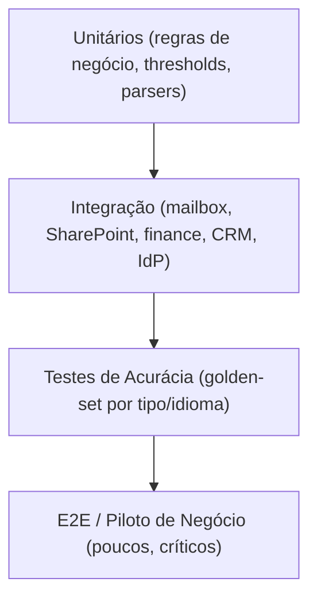

# Modelo de Testes — Intelligent Operations Document Platform

**Versão:** 1.0
**Data:** 2026-07-19
**Escopo:** (A) validação do pipeline de artefatos gerado pelo framework requirements-intel; (B) estratégia de testes da plataforma proposta em `architecture.md`, cobrindo NFR-012 e a exigência do RFP §17.4 de "test plan e evidência".

---

## Parte A — Validação do Pipeline (meta-teste dos artefatos)

Execução do `aios-core/checklists/pipeline-quality.md` contra os 5 artefatos gerados:

| Fase | Gate | Resultado |
|------|------|-----------|
| Discovery | 7/7 | ✅ Problema em 1-2 frases, 10 stakeholders, 12 RQs, restrições, premissas/riscos, métricas, nenhuma solução técnica prescrita |
| PRD | 6/6 | ✅ 4 personas cobertas, 21 FRs + 15 NFRs, rastreabilidade 100% a RQ-XXX, "Fora de Escopo" preenchido, critérios de sucesso mensuráveis |
| Arquitetura | 7/7 | ✅ 15 NFRs cobertos, 3 ADRs com alternativas, 5 riscos técnicos com mitigação, diagramas Context/Container descritos, segurança e escalabilidade explicitadas, dependências (mailbox/SharePoint/finance/CRM/IdP) com SLA "a confirmar" sinalizado |
| Backlog | 7/7 | ✅ 100% dos FRs cobertos por stories, nenhuma story > 13pts sem decomposição, ACs em Given/When/Then, sem ciclos de dependência, Sprint 1 realista (47pts), rastreabilidade 100%, stories técnicas incluídas (EPIC-00) |
| Business Case | 7/7 | ✅ Custos com premissa documentada, benefícios quantificados com fórmula explícita, ROI/payback/NPV calculados, análise de sensibilidade 3 cenários (corrigida nesta execução), 3 alternativas avaliadas (Build/Buy/Integrate), recomendação clara (GO com ressalvas), resumo executivo em 1 parágrafo |

**Rastreabilidade End-to-End:**

| Camada | Status |
|--------|--------|
| RQ → FR/NFR | ✅ RQ-001 a RQ-012 → FR-001 a FR-021 + NFR-001 a NFR-015 |
| FR → Story | ✅ Todos os FR Must/Should têm story em backlog.md §"Rastreabilidade Stories → FR" |
| Story → Sprint | ✅ Sprint 1 = 47pts, dentro do limite 40-60 |
| NFR → ADR | ✅ Tabela "Cobertura de NFRs" em architecture.md mapeia todos os 15 NFRs a fase TOGAF/ADR |
| Discovery → Business Case | ✅ Benefícios (§5.1) referenciam volumes e dores do discovery-report.md §4.3 |

**Veredito do pipeline:** APROVADO, com 2 ressalvas herdadas do RFP (sistema financeiro/CRM alvo indefinido; volumes não validados) — ambas já sinalizadas como condição de GO no business-case.md §9.

---

## Parte B — Estratégia de Testes da Plataforma

### B.1 Pirâmide de Testes



### B.2 Camadas e Critério de Aceite

| Camada | O que testa | Ferramenta sugerida | Critério de aceite | Rastreabilidade |
|--------|--------------|----------------------|----------------------|-------------------|
| Unitário | Regras determinísticas de threshold, dedup, parsing de campos | xUnit / Jest / pytest no pipeline CI | Cobertura ≥ 80% em componentes de decisão de roteamento | NFR-012 |
| Integração/Contrato | Conectores mailbox, SharePoint, sistema financeiro, CRM, Entra ID | Testes de contrato (Pact) + mocks de sandbox | 100% dos contratos com teste de sucesso + teste de falha/retry | FR-001, FR-004, FR-014, FR-015 |
| Acurácia (golden-set) | Classificação e extração por tipo de documento e idioma (EN/PT/IT) | Conjunto de teste rotulado (mín. 200 docs/idioma/tipo) | ≥ 90% classificação, ≥ 85% extração de campos prioritários | Critérios de sucesso do PRD §10, FR-006/007/020 |
| Segurança | AuthN/AuthZ, secrets, redação de PII em log, criptografia | SAST/DAST + revisão manual pré-go-live | 0 achados críticos/altos abertos no go-live | NFR-007, NFR-008, NFR-009 |
| Performance/Carga | Latência de fila, tempo de processamento, capacidade mensal | k6 / Azure Load Testing | ≤ 3s p95 fila, ≤ 60s p95 processamento, suporta 250k páginas/mês | NFR-002, NFR-003, NFR-004 |
| Resiliência | Retry, dead-letter, failover, RPO/RTO | Chaos test (derrubar Service Bus/DB em staging) | RPO ≤ 15min, RTO ≤ 4h | NFR-005, NFR-006 |
| Governança de IA (específico) | Nenhum campo crítico roteado sem aprovação humana | Teste funcional dedicado ao gate FR-012 | 100% dos campos críticos de baixa confiança bloqueados até aprovação | FR-012, BR-005 do RFP |
| Acessibilidade | Fila de validação (Web App) | axe-core / auditoria manual | WCAG 2.1 AA sem violação crítica | NFR-011 |
| Auditoria/Lineage | Todo registro aprovado é rastreável à fonte | Teste de trilha: amostra aleatória de N registros aprovados | 100% com lineage completo (fonte→campo→ação) | NFR-010, FR-017, FR-019 |
| UAT (piloto de negócio) | Reviewers reais executam o workflow completo | Sessão supervisionada com Finance/CustOps | ≥ 80% dos reviewers concluem o fluxo após treinamento | Critério de sucesso do PRD §10 |

### B.3 Caso de Teste Crítico — Gate de Governança de IA (prioridade máxima)

```
Dado um documento com campo crítico "valor da fatura" extraído com confiança 0.62 (abaixo do threshold configurado de 0.85)
Quando o pipeline avalia o resultado
Então o item deve ficar em status "pending_approval"
E nenhum evento de roteamento para o sistema financeiro deve ser publicado
E uma tentativa manual/automática de forçar o roteamento sem aprovação deve ser rejeitada e registrada em auditoria
Quando um Finance Reviewer aprova o item
Então o evento de roteamento é publicado
E o registro de auditoria referencia ator + timestamp + valor aprovado
```
Este caso é o teste de aceite não-negociável do programa (deriva diretamente de RQ-005 / BR-005 do RFP) e deve bloquear o go-live se falhar.

### B.4 Matriz de Execução por Fase de Entrega

| Work Package (architecture.md §E.1) | Testes aplicáveis nesta fase |
|--------------------------------------|-------------------------------|
| WP-01 Foundation & Security | Unitário (config), Segurança (IAM baseline) |
| WP-02 Intake Governado | Integração (mailbox/SharePoint), Resiliência (retry/dead-letter) |
| WP-03 Classificação/Extração | Acurácia (golden-set), Unitário (parsers) |
| WP-04 Validação Humana | Governança de IA (caso crítico B.3), Acessibilidade |
| WP-05 Roteamento | Integração (finance/CRM), Resiliência (falha recuperável) |
| WP-06 Auditoria/Dashboards | Auditoria/Lineage, Performance (dashboards) |
| Pilot (RFP §17.4) | E2E completo + UAT + Performance/Carga + Segurança final |

### B.5 Saída Esperada (evidência para o RFP §17.4)

- Relatório de execução por camada com pass/fail e cobertura.
- Golden-set de acurácia versionado (por tipo de documento × idioma) reexecutável a cada mudança de modelo/prompt (rastreável via FR-010).
- Relatório de teste de segurança/privacidade assinado antes do go-live (bloqueante, ligado a RT-03 em architecture.md).
- Relatório de UAT com taxa de proficiência dos reviewers (meta ≥ 80%).
- Todos os relatórios anexados como evidência no `business-case.md` / relatório executivo de decisão go-live.

---

## Histórico de Versões

| Versão | Data | Autor | Mudança |
|--------|------|-------|---------|
| 1.0 | 2026-07-19 | Pipeline requirements-intel (revisão final) | Modelo de testes do pipeline (Parte A) + estratégia de testes da plataforma (Parte B) |
