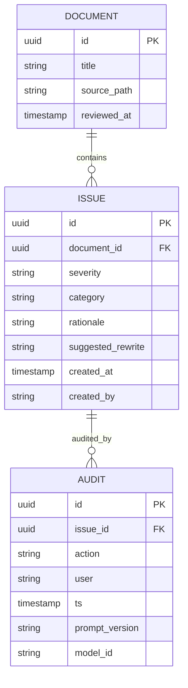
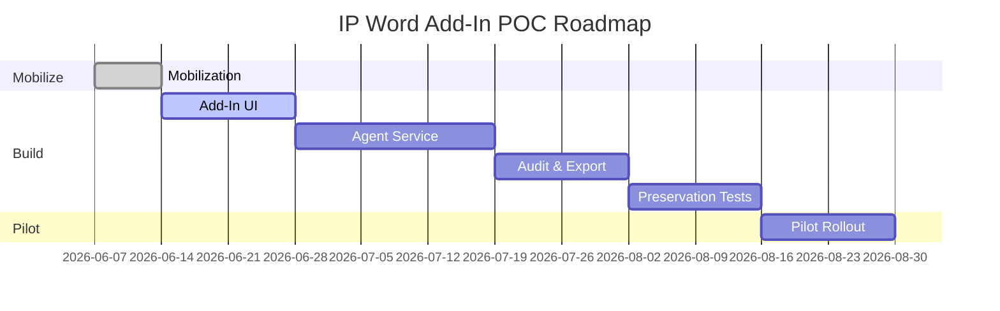

# Architecture — IP Document Draft Evaluation (Word Add-In)

**Versão:** 1.0  
**Data:** 2026-06-03  
**Autor:** Aria (@architect) — DPABB Framework  
**Metodologia:** TOGAF 10 — ADM Phases A–E  
**PRD:** [docs/output/ip-word-addin/prd.md](docs/output/ip-word-addin/prd.md)  
**Status:** Draft

---

## Phase A — Architecture Vision

### A.1 Declaração de Problema de Negócio

**Capacidade atual (As-Is):** Revisões de rascunhos de patentes são majoritariamente manuais, inconsistentes e sem trilha auditável.  
**Capacidade alvo (To-Be):** Assistência governada em documento: detecção consistente de problemas, comentários padronizados e logs auditáveis por documento/ação.  
**Gap:** Falta de automação confiável integrada ao fluxo do Word que preserve comentários e track-changes.

### A.2 Princípios Arquiteturais

| # | Princípio | Implicação |
|---|-----------|-----------|
| PA-01 | Microsoft-first / Tenant Isolation | Usar Entra ID, tenant-scoped storage e PaaS gerenciado sempre que possível |
| PA-02 | Human-in-the-loop | Todas as ações de alta severidade requerem validação humana |
| PA-03 | Preserve Document Fidelity | Preferir Office.js e track-changes; fallback não-invasivo (export report) |
| PA-04 | Observability First | Logs, métricas e auditoria por ação/prompt/model |

### A.3 Stakeholder Architecture Concerns

| Stakeholder | Preocupação | Como a arquitetura endereça |
|-------------|------------|---------------------------|
| Reviewers | Preservar comentários/UX | Office Add-In com Office.js; testes cross-client (WP-4) |
| Legal Ops | Auditabilidade e relatórios | Audit store tenant-scoped + QC exports |
| Security/Compliance | Data residency / LGPD | Tenant storage preferred; consented central store fallback |
| Platform/IT | Operação e integridade | PaaS (Functions/App Service), managed identities, APIM |

### A.4 Diagrama de Contexto (C4 L1)

### A.5 Classificação de Complexidade

| Dimensão | Score (1-5) | Justificativa |
|----------|------------:|--------------|
| Escopo | 3 | POC limitado a QC e auditabilidade |
| Integração | 3 | Integrações simples com SharePoint/OneDrive (push) |
| Infraestrutura | 2 | PaaS-first reduz complexidade infra |
| Conhecimento | 3 | Requer expertise em Office.js e prompt engineering |
| Risco | 3 | Preservação de documentos e compliance são riscos-chave |
| **Total** | **14/25** | |

**Classe:** STANDARD  
**Estilo recomendado:** Add-In (Office.js) + Backend orchestrator (Functions/Foundry)

## Phase B — Business Architecture
- Capabilities required:
  - In-document QC execution
  - Structured feedback and issue management
  - Audit and reporting
  - Integration with DMS for metadata/report push
- High-level To-Be flow:
  1. Reviewer opens `.docx` in Word → launches Add-In
  2. Reviewer selects context docs (IDF, prior art) if needed
  3. Reviewer triggers QC → Add-In captures ranges and sends to backend
  4. Backend runs prompts, returns structured issues
  5. Add-In inserts comments/redlines, records audit metadata
  6. Reviewer accepts/ignores/resolves items; audit log updated

## Phase C — Information Systems Architecture

### C1 — Data Architecture (conceptual)

### C2 — Application Architecture (container-level)

## Phase D — Technology Architecture
- Recommended POC components:
  - Add-In: Office Web Add-in (HTML/JS) hosted via Azure App Service or static hosting; uses Office JS APIs for comments/track-changes manipulation.
  - Backend Agent: Azure Functions (HTTP) or Foundry-hosted agent to run prompt sets and return structured JSON.
  - Auth: Azure AD (Entra) for SSO and user attribution.
  - Storage: Azure SQL for metadata; Blob Storage for attachments; Application Insights for telemetry.
  - API Gateway: Azure API Management for routing and tenant policies.
- Security & Network:
  - TLS everywhere; managed identities for service-to-service auth.
  - Tenant isolation: data stored within customer tenant storage where required.
  - Conditional access: restrict Add-In use to approved tenants/users.

## Phase E — Opportunities & Solutions (implementation roadmap)
- Work packages (POC):
  1. WP-1: Add-In UI + basic comment insertion (Week 1–2)
  2. WP-2: Backend prompt orchestrator + simple issue detector (Week 3–6)
  3. WP-3: Audit log + export report (Week 5–7)
  4. WP-4: Cross-client preservation tests (Win Desk, Word Web) (Week 6–8)
  5. WP-5: Pilot rollout + metrics collection (Week 9–10)

### Roadmap (gantt)

## ADRs

### ADR-001: Model Hosting — Foundry-hosted vs Tenant-hosted
**Status:** Proposed
**Date:** 2026-06-03
**Fase TOGAF:** Phase D
**NFRs relacionados:** NFR-4 (Security), NFR-1 (Auth), NFR-5 (Auditability)

#### Context
The POC must run LLM-based prompt sets to generate structured QC feedback. Two hosting options are viable: (A) run model invocations via a Foundry-hosted deployment (managed service) and (B) deploy model runtime inside the customer's tenant (tenant-hosted). Foundry-hosted offers speed of setup and operational simplicity; tenant-hosted offers stronger data residency and compliance control.

#### Decision
For the POC: use Foundry-hosted model deployments with strict tenant scoping and telemetry opt-out options. For production, offer tenant-hosted as an enterprise option where regulatory or contractual constraints require it.

#### Alternatives Considered
| Alternativa | Por que foi rejeitada |
|-------------|----------------------|
| Tenant-hosted (tenant VNet + private endpoints) | Not selected for POC due to higher setup time and infra operational overhead for pilot; keep as production option. |
| Hybrid (Foundry inference + tenant-only audit storage) | Considered; adds complexity but remains an option — partially accepted as a mitigation (see Consequences). |

#### Consequences
**Positivas:**
- Rapid POC delivery and simplified ops using Foundry-hosted models.
- Centralized model versioning and prompt management for iteration.

**Negativas / Trade-offs:**
- Increased customer concerns about data leaving tenant — mitigate with clear telemetry opt-out and anonymization.
- May require tenant-hosted migration for regulated customers, adding time/cost.

#### Review
Revisit this ADR before production rollout or if a pilot customer mandates tenant-only processing.

### ADR-002: Comment & Track-Changes Preservation Strategy
**Status:** Proposed
**Date:** 2026-06-03
**Fase TOGAF:** Phase C2
**NFRs relacionados:** NFR-2 (Preservation), NFR-3 (Latency)

#### Context
The Add-In must insert AI-generated comments/redlines while preserving pre-existing attorney comments and track-changes across supported Word clients (Desktop Win, Word Web, Mac). Manipulating Word content programmatically risks losing comment metadata or altering track-changes history.

#### Decision
Use Office JavaScript APIs (Office.js) for comment insertion and the Word Open XML (OOXML) pathway only when Office.js lacks functionality for a specific client; implement conservative edits using track-changes APIs where available. Provide a safe fallback "Export QC Report" mode (non-invasive) if client APIs cannot guarantee preservation for a given environment.

#### Alternatives Considered
| Alternativa | Por que foi rejeitada |
|-------------|----------------------|
| Direct OOXML patching without Office.js | Rejected for POC due to higher risk of corrupting document in some clients and complexity of merging existing comments/changes. |
| Apply edits as new document version (detached) | Rejected for pilot UX reasons — reviewers expect in-place comments and track-changes. |

#### Consequences
**Positivas:**
- Leverages supported Add-In APIs for best-compatibility across clients.
- Fallback export mode ensures no data loss in unsupported clients.

**Negativas / Trade-offs:**
- Some advanced edits may have higher latency due to API constraints.
- Additional QA needed to validate behavior across Word Desktop, Web, and Mac clients.

#### Review
Run cross-client preservation tests during WP-4 (Preservation Tests) and update this ADR to Accepted/Adjusted after validation.

### ADR-003: Data Residency, Audit Storage & Tenant Isolation
**Status:** Proposed
**Date:** 2026-06-03
**Fase TOGAF:** Phase D
**NFRs relacionados:** NFR-4 (Security), NFR-5 (Auditability)

#### Context
Audit logs and minimal metadata must be retained for compliance (LGPD) and traceability. Design must balance POC speed with customer requirements for data residency and tenant isolation.

#### Decision
Default POC behavior: store audit metadata and telemetry in tenant-scoped storage when tenant storage is available (preferred). When tenant storage is not available for the pilot, store anonymized telemetry in a secured central store with explicit customer consent. Production will require tenant-isolated storage or contractual assurances.

#### Alternatives Considered
| Alternativa | Por que foi rejeitada |
|-------------|----------------------|
| Always central multi-tenant storage | Rejected due to LGPD and enterprise compliance concerns. |
| No telemetry / no logs | Rejected because auditability is a core use-case requirement.

#### Consequences
**Positivas:**
- Meets compliance needs where tenant storage is possible.
- Enables pilot flexibility with consent-based central storage.

**Negativas / Trade-offs:**
- Implementing tenant-scoped storage per-customer increases implementation complexity and testing.
- Consent flows and documentation required for central storage usage in pilot.

#### Review
Re-evaluate before production; make tenant-isolated storage mandatory for regulated customers.

## Technical Risks
- R1: Preservation of comments/track-changes across Word clients — Mitigation: perform early cross-client tests and implement conservative edits using track-changes API.
- R2: Model hallucination on legal language — Mitigation: human-in-loop and conservative prompt templates; label suggested rewrites with provenance and confidence.
- R3: Data residency / LGPD — Mitigation: tenant-isolated storage option and telemetry opt-out for pilot.

## Team Plan (summary)
- Core team: 1 Product Owner, 1 Tech Lead, 2 Developers (Frontend + Backend), 1 QA, 1 Security Reviewer, 2 Pilot Reviewers.
- Estimated POC duration: ~10 weeks.

## Next Steps
1. Approve ADR-001 (Foundry-hosted for POC) or select tenant-hosted.
2. Confirm pilot reviewers and sample documents (10–15).
3. Kick off WP-1 (Add-In UI) with CI/CD stub and instrumentation.

Prepared by: Aria (@architect) — DPABB Framework
