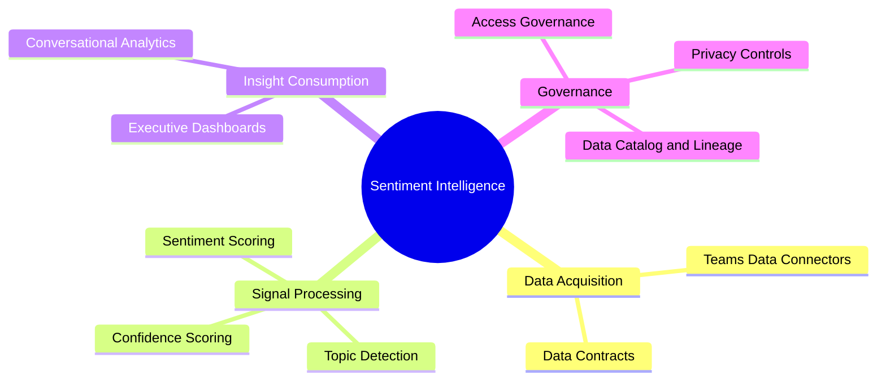
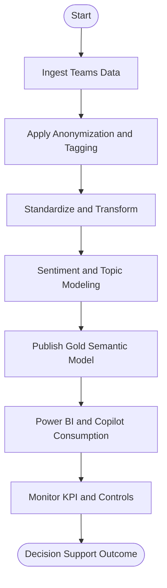
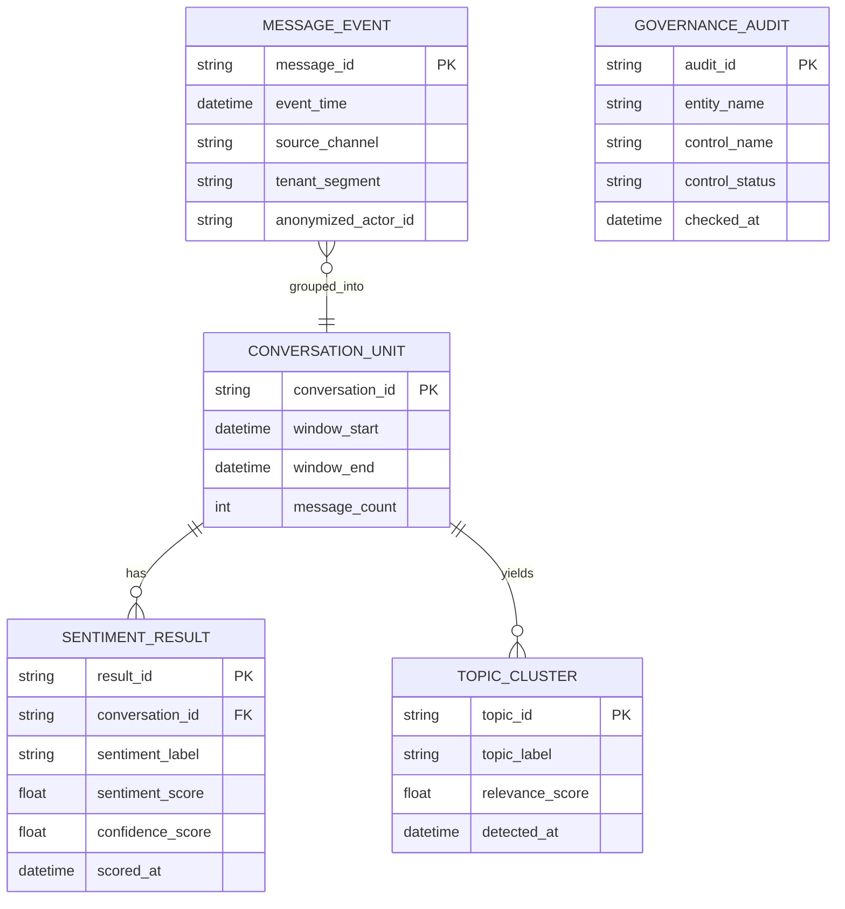
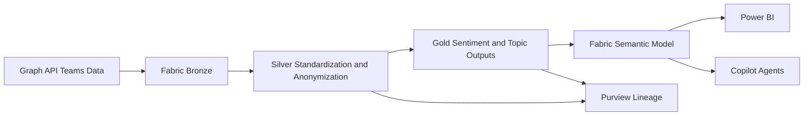
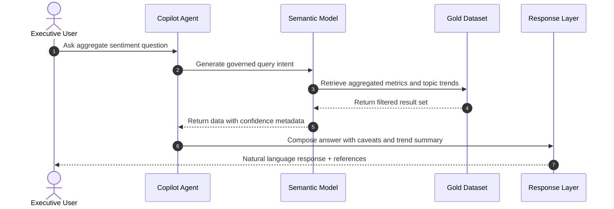
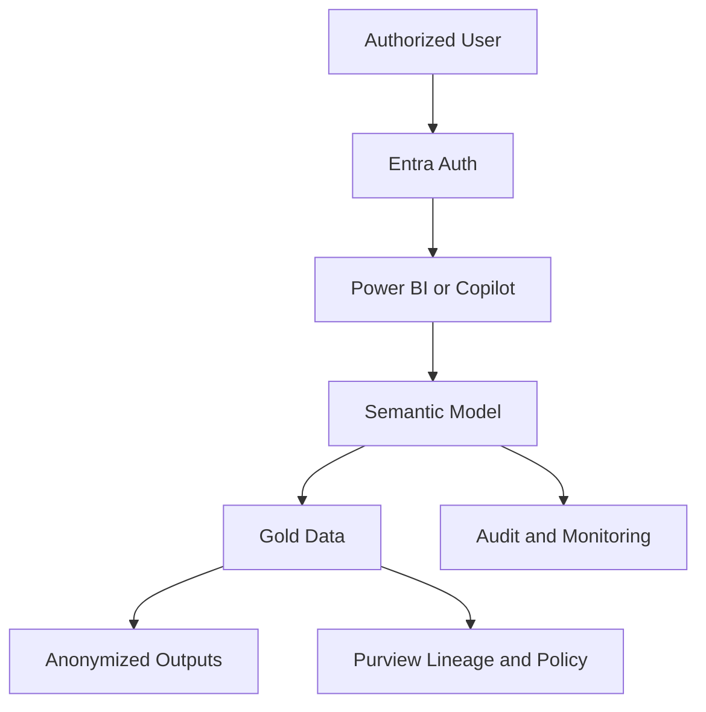
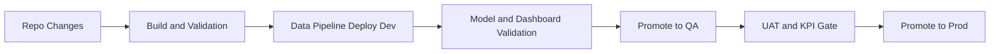
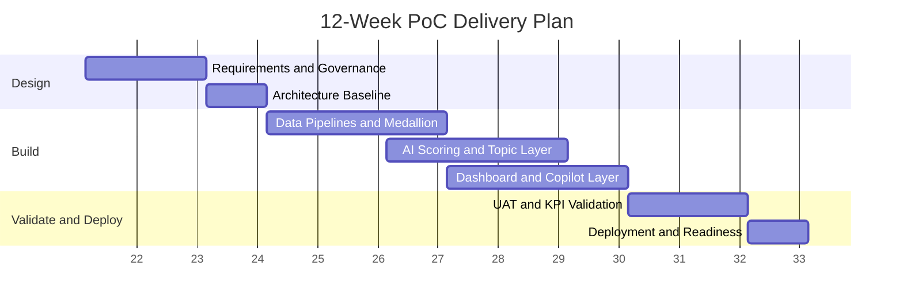

# Architecture - T-Mobile Sentiment Analysis Prototype

**Version:** 1.0  
**Date:** 2026-06-01  
**Author:** @architect (Aria)  
**Methodology:** TOGAF 10 - ADM Phases A-E  
**PRD:** prd.md  
**Status:** Approved

---

## Phase A - Architecture Vision

### A.1 Business Problem Statement

T-Mobile requires a governed analytics capability to transform Teams communication data into trusted aggregate sentiment and topic signals for executive decision making, without exposing personal data.

**As-Is capability:** limited, manual, fragmented sentiment interpretation.  
**To-Be capability:** governed, near-self-service, AI-assisted trend intelligence.  
**Gap:** no current enterprise-grade data + AI pattern for this use case.

### A.2 Architectural Principles

| # | Principle | Implication |
|---|-----------|-------------|
| PA-01 | Privacy by Design | Anonymization and anti re-identification controls are mandatory in data flows |
| PA-02 | Single Semantic Truth | Dashboard and Copilot agents must consume one governed semantic model |
| PA-03 | Observability First | Full pipeline and model monitoring with actionable alerts |
| PA-04 | Responsible AI Guardrails | Confidence indicators, quality thresholds, and human review loops |
| PA-05 | Microsoft-Native Delivery | Fabric, Azure AI, Power BI, Purview, Entra, and DevOps patterns only |

### A.3 Stakeholder Concerns and Responses

| Stakeholder | Concern | Architectural Response |
|-------------|---------|-----------------------|
| Executive Sponsor | Insight speed and trust | Curated Gold model + confidence-aware outputs |
| HR Analytics | Signal usability | Trend/topic layers + conversational querying |
| Governance Lead | Privacy and compliance | Data minimization, RBAC, lineage, audit trail |
| Platform Lead | Deployability and scale path | Medallion architecture + environment promotion model |

### A.4 Context Diagram (C4 L1)

```mermaid
architecture-beta
  group users(mdi:account-group)[Business Users]
  group m365(mdi:api)[M365 Sources]
  group cloud(azure:azure)[Microsoft Cloud]

  service exec(mdi:account-group)[Executive and HR Users] in users
  service teams(mdi:api)[Teams via Graph API] in m365

  service fabric(azure:analytics)[Microsoft Fabric] in cloud
  service ai(azure:openai)[Azure AI Services] in cloud
  service pbi(azure:power-bi-embedded)[Power BI] in cloud
  service copilot(azure:copilot)[Copilot Portal] in cloud
  service purview(azure:purview-accounts)[Microsoft Purview] in cloud
  service entra(azure:azure-active-directory)[Entra ID] in cloud

  teams:R --> L:fabric
  fabric:R --> L:ai
  fabric:T --> B:purview
  exec:R --> L:pbi
  exec:B --> T:copilot
  copilot:R --> L:fabric
  pbi:T --> B:entra
  copilot:T --> B:entra
```

### A.5 Complexity Classification

| Dimension | Score (1-5) | Justification |
|-----------|-------------|---------------|
| Scope | 4 | Multi-layer data + AI + BI + conversational experience |
| Integration | 4 | Graph, Fabric, Purview, Power BI, Copilot integration |
| Infrastructure | 3 | Managed PaaS-first design |
| Knowledge | 4 | Requires data/AI/governance cross-domain expertise |
| Risk | 4 | Sensitive data and model trust constraints |
| **Total** | **19/25** | |

**Class:** COMPLEX  
**Recommended style:** Layered medallion + semantic model + agentic analytics pattern.

---

## Phase B - Business Architecture

### B.1 Capability Map

### B.2 To-Be Process Flow

### B.3 Actor vs Capability Matrix

| Capability | Executive | HR Analytics | Governance Lead | Platform Team |
|------------|-----------|--------------|-----------------|---------------|
| Trend monitoring | Consume | Consume/Analyze | Oversight | Support |
| Topic exploration | Consume | Analyze | Oversight | Support |
| Privacy governance | View status | View status | Own | Implement |
| Deployment operations | Inform | Inform | Review | Own |

---

## Phase C - Information Systems Architecture

### C1 - Data Architecture

#### C1.1 Conceptual ER Diagram

#### C1.2 Storage Strategy

| Data Type | Technology | Justification | NFR Coverage |
|-----------|------------|---------------|--------------|
| Raw ingested records (Bronze) | Fabric Lakehouse | Scalable append and governed storage | NFR-005, NFR-006 |
| Curated analysis tables (Silver/Gold) | Fabric Warehouse/Lakehouse | Strong analytics integration and semantic serving | NFR-001, NFR-007 |
| Semantic model | Fabric Semantic Model | Unified consumption layer for BI and Copilot | NFR-001, NFR-002 |
| Metadata and lineage | Purview | Compliance and traceability | NFR-007 |
| Operational telemetry | Azure Monitor and App Insights | Reliability and SLA operations | NFR-008 |

#### C1.3 Data Flow

#### C1.4 Privacy Policy Mapping

| Personal Data Element | Handling | Retention | Control |
|-----------------------|----------|-----------|---------|
| User identity fields | Tokenized/anonymized before Gold layer | Policy-bound | RBAC + audit |
| Message body text | Processed for aggregate signals; restricted view | Policy-bound | Access segregation |
| Operational logs | No raw personal text in logs | 90 days (PoC default) | Monitoring controls |

### C2 - Application Architecture

#### C2.1 Component Catalog

| Component | Responsibility | Technology | Exposes | Consumes |
|-----------|----------------|-----------|---------|----------|
| Ingestion pipeline | Pull and normalize Teams data | Fabric Data Factory/Dataflows | Internal datasets | Graph API |
| AI scoring service | Sentiment and topic scoring | Azure AI Language + Azure OpenAI | Scored outputs | Silver data |
| Semantic model | Governed analytical interface | Fabric Semantic Model | BI/Agent query model | Gold data |
| BI layer | Executive trend and topic views | Power BI | Dashboards | Semantic model |
| Copilot multi-agent layer | Conversational insight generation | Copilot + orchestration agents | NL response | Semantic model |
| Governance layer | Catalog, lineage, policy evidence | Purview | Governance metadata | Fabric assets |

#### C2.2 Container Diagram (C4 L2)

```mermaid
architecture-beta
  group source(mdi:api)[Source]
  group data(azure:analytics)[Data Platform]
  group ai(azure:openai)[AI Layer]
  group consume(mdi:monitor)[Consumption]
  group gov(azure:purview-accounts)[Governance]

  service graph(mdi:api)[Graph API] in source
  service bronze(azure:data-factory)[Bronze Ingestion] in data
  service silver(azure:data-lake)[Silver Processing] in data
  service gold(azure:data-lake)[Gold Curated] in data
  service model(azure:power-bi-embedded)[Semantic Model] in data

  service lang(azure:cognitive-services)[Azure AI Language] in ai
  service aoai(azure:openai)[Azure OpenAI] in ai

  service pbi(mdi:monitor)[Power BI Dashboards] in consume
  service agent(mdi:account-group)[Copilot Agents] in consume

  service purview(azure:purview-accounts)[Purview] in gov
  service entra(azure:azure-active-directory)[Entra ID] in gov

  graph:R --> L:bronze
  bronze:R --> L:silver
  silver:R --> L:gold
  silver:T --> B:lang
  silver:B --> T:aoai
  gold:R --> L:model
  model:R --> L:pbi
  model:B --> T:agent
  bronze:T --> B:purview
  gold:T --> B:purview
  pbi:T --> B:entra
  agent:T --> B:entra
```

#### C2.3 Sequence Diagram - Main Query Flow

---

## Phase D - Technology Architecture

### D.1 Technology Decisions

| Domain | Decision | Rationale |
|--------|----------|-----------|
| Data platform | Fabric medallion + semantic model | Governed analytics and unified consumption |
| AI services | Azure AI Language + Azure OpenAI | Combination of deterministic and generative analysis |
| Identity | Entra ID RBAC | Centralized access governance |
| Monitoring | Azure Monitor/App Insights | End-to-end reliability and SLA metrics |
| Deployment | Azure DevOps/GitHub enterprise pipelines | Environment promotion and repeatability |

### D.2 Security and Network Controls

### D.3 CI/CD Pattern

### D.4 External Dependencies and SLA Considerations

| Dependency | Purpose | SLA Consideration |
|------------|---------|-------------------|
| Microsoft Graph API | Teams data extraction | API rate limits and permission continuity |
| Fabric capacity | Data processing and semantic serving | Throughput and refresh scheduling windows |
| Azure AI services | Sentiment/topic processing | Latency and quota management |
| Power BI service | Dashboard consumption | Capacity and concurrency planning |

---

## Phase E - Opportunities and Solutions

### E.1 Work Packages

| WP | Description | Outcome |
|----|-------------|---------|
| WP-01 | Governance and data access setup | Approved and auditable ingestion scope |
| WP-02 | Fabric ingestion and medallion pipelines | Reliable Bronze/Silver/Gold flows |
| WP-03 | AI scoring and quality tuning | Validated sentiment/topic quality |
| WP-04 | Dashboard and Copilot experience | Executive self-service analytics |
| WP-05 | Monitoring, deployment, and readiness gate | Production-ready PoC baseline |

### E.2 Delivery Roadmap (12 Weeks)

### E.3 Architecture Decision Records (ADRs)

| ADR | Decision | Accepted Alternative(s) | Rejected Alternative(s) |
|-----|----------|-------------------------|--------------------------|
| ADR-001 | Fabric medallion architecture is mandatory | Lakehouse-only baseline | Flat ETL without layered governance |
| ADR-002 | Hybrid AI strategy (Language + OpenAI) | Single-model baseline | Generative-only model path for all scoring |
| ADR-003 | Aggregate analytics only for PoC consumers | Granular analyst-only extension in later phase | Employee-level insight exposure in PoC |
| ADR-004 | Copilot portal for conversational UX | Custom web chat in later phase | New standalone frontend for PoC |

### E.4 Team Model (Phase Peak)

| Role | FTE | Notes |
|------|-----|-------|
| Delivery Lead / PM | 1.0 | Program and stakeholder governance |
| AI Architect | 1.0 | End-to-end AI and responsible AI guardrails |
| Data Architect/Engineer | 1.0 | Fabric data platform design and implementation |
| AI Engineers | 2.0 | Sentiment/topic modeling and agent behavior |
| Power BI Developer | 1.0 | Executive dashboards and semantic modeling |
| QA Engineer | 1.0 | Validation, non-functional, and UAT evidence |

---

## NFR Coverage Matrix

| NFR | Architectural Control |
|-----|------------------------|
| NFR-001 | Curated semantic model and tuned dashboard model |
| NFR-002 | Agent query routing and caching policy |
| NFR-003 | Entra RBAC and least privilege role model |
| NFR-004 | Anonymization pipeline and restricted data exposure |
| NFR-005 | Retry, alerting, and operational monitoring |
| NFR-006 | Capacity and cost scenario model |
| NFR-007 | Purview catalog/lineage integration |
| NFR-008 | Unified telemetry and incident alerting |

---

## Version History

| Version | Date | Author | Change |
|---------|------|--------|--------|
| 1.0 | 2026-06-01 | @architect | Initial approved version |
