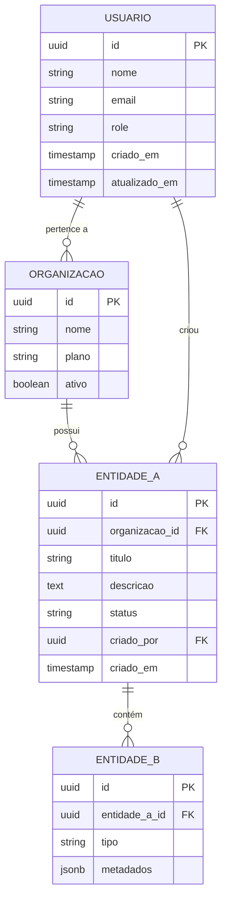
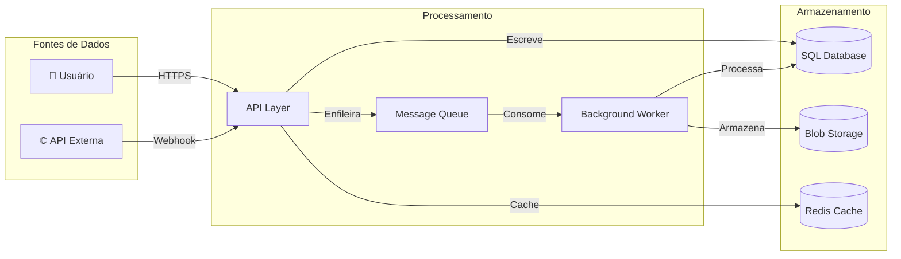
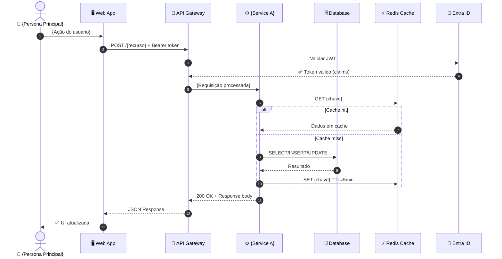
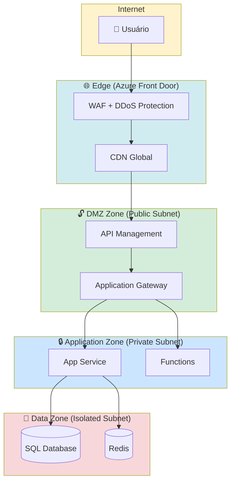
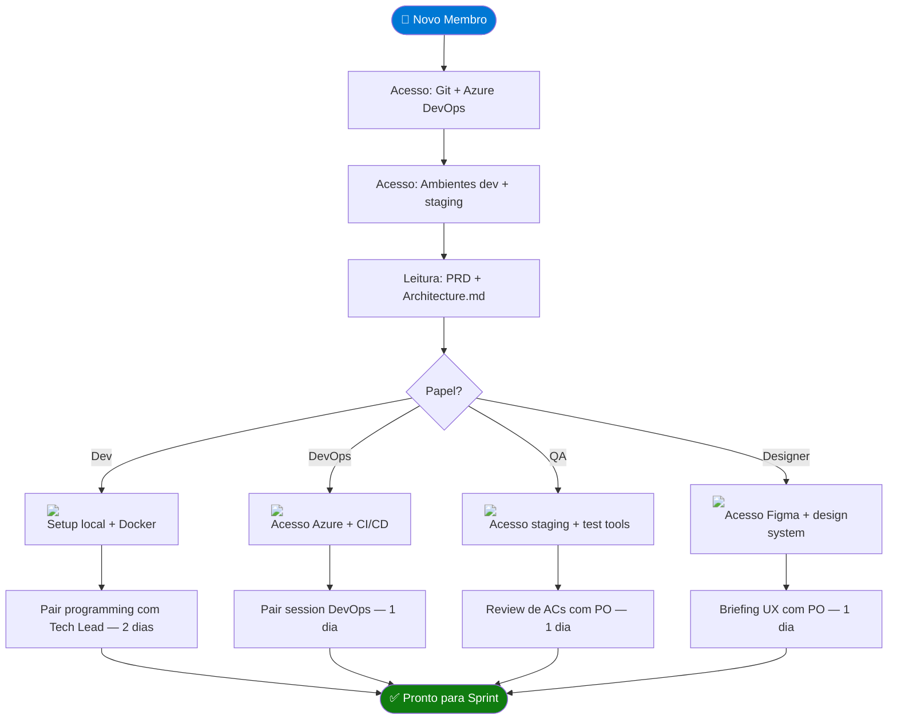

# Architecture — {PROJETO}

**Versão:** 1.0  
**Data:** {DATA}  
**Autor:** @architect (Aria)  
**Metodologia:** TOGAF 10 — ADM Phases A–E  
**PRD:** [prd.md](../prd/prd.md)  
**Status:** Draft | In Review | Approved

---

## Phase A — Architecture Vision

### A.1 Declaração de Problema de Negócio

> Síntese do discovery: qual capacidade de negócio está ausente ou deficiente?

**Capacidade atual (As-Is):** ...  
**Capacidade alvo (To-Be):** ...  
**Gap:** ...

### A.2 Princípios Arquiteturais

| # | Princípio | Implicação |
|---|-----------|-----------|
| PA-01 | Security by Design | Autenticação e RBAC implementados desde o MVP |
| PA-02 | Observability First | Logs, métricas e traces em todos os serviços |
| PA-03 | API-First | Contratos definidos antes da implementação |
| PA-04 | {Princípio específico do projeto} | {implicação} |

### A.3 Stakeholder Architecture Concerns

| Stakeholder | Preocupação | Como a arquitetura endereça |
|-------------|------------|---------------------------|
| {Sponsor} | Custo de operação | Serverless / PaaS reduz ops overhead |
| {Dev team} | Velocidade de entrega | Monolito modular reduz coordenação |
| {Security} | Compliance LGPD | Criptografia em repouso + RLS |

### A.4 Diagrama de Contexto (C4 Level 1)


### A.5 Classificação de Complexidade

| Dimensão | Score (1-5) | Justificativa |
|----------|------------|--------------|
| Escopo | | |
| Integração | | |
| Infraestrutura | | |
| Conhecimento | | |
| Risco | | |
| **Total** | **/25** | |

**Classe:** SIMPLE / STANDARD / COMPLEX  
**Estilo recomendado:** {Monolito Modular / BFF+SPA / Microservices / Event-Driven}

---

### A.6 Legenda de Componentes Azure

> Ícones oficiais Microsoft Azure usados nos diagramas. Nos diagramas Mermaid usa-se o prefixo `azure:` (Iconify online). Nos documentos HTML usa-se `` com os SVGs locais abaixo.

<div align="center">

#### Camada de Entrada e API

| <br>**Front Door + WAF** | <br>**API Management** | <br>**App Gateway** | <br>**Load Balancer** |
|:---:|:---:|:---:|:---:|
| `azure:front-door` | `azure:api-management` | `azure:application-gateway` | `azure:load-balancer` |

#### Camada de Aplicação

| <br>**App Service** | <br>**Function Apps** | <br>**AKS** | <br>**Container Instances** |
|:---:|:---:|:---:|:---:|
| `azure:app-service` | `azure:functions` | `azure:kubernetes-service` | `azure:container-instances` |

#### Camada de Dados

| <br>**SQL Database** | <br>**Cosmos DB** | <br>**Redis Cache** | <br>**Storage** |
|:---:|:---:|:---:|:---:|
| `azure:sql-database` | `azure:cosmos-db` | `azure:cache-for-redis` | `azure:storage-accounts` |

#### Segurança e Identidade

| <br>**Entra ID** | <br>**AD B2C** | <br>**Key Vault** | <br>**Defender** |
|:---:|:---:|:---:|:---:|
| `azure:azure-active-directory` | `azure:azure-ad-b2c` | `azure:key-vault` | `azure:defender-for-cloud` |

#### Integração e Mensageria

| <br>**Service Bus** | <br>**Event Grid** | <br>**Event Hubs** | <br>**Logic Apps** |
|:---:|:---:|:---:|:---:|
| `azure:service-bus` | `azure:event-grid` | `azure:event-hubs` | `azure:logic-apps` |

#### Monitor, DevOps e IA

| <br>**Monitor** | <br>**App Insights** | <br>**Azure DevOps** | <br>**Azure OpenAI** |
|:---:|:---:|:---:|:---:|
| `azure:monitor` | `azure:application-insights` | `azure:devops` | `azure:openai` |

</div>

> Catálogo completo: [`assets/icons/azure/AZURE-ICONS.md`](../../assets/icons/azure/AZURE-ICONS.md) — 705 ícones em 30 categorias.

---

## Phase B — Business Architecture

### B.1 Mapa de Capacidades de Negócio

```mermaid
mindmap
  root({PROJETO})
    Gestão de {Domínio A}
      {Capacidade 1}
      {Capacidade 2}
    Gestão de {Domínio B}
      {Capacidade 3}
      {Capacidade 4}
    Administração
      Usuários e Permissões
      Configurações
      Relatórios
```

### B.2 Fluxo de Processo — To-Be

```mermaid
flowchart TD
  A([🚀 Início]) --> B[{Passo 1}]
  B --> C{Decisão?}
  C -->|Sim| D[{Caminho A}]
  C -->|Não| E[{Caminho B}]
  D --> F([✅ Fim])
  E --> F

  style A fill:#0078d4,color:#fff
  style F fill:#107c10,color:#fff
```

### B.3 Matriz Ator × Capacidade

| Capacidade | {Persona 1} | {Persona 2} | {Admin} |
|-----------|------------|------------|--------|
| {Capacidade 1} | CRUD | Leitura | CRUD |
| {Capacidade 2} | — | CRUD | CRUD |

---

## Phase C — Information Systems Architecture

### C1 — Data Architecture

#### C1.1 Diagrama ER Conceitual



#### C1.2 Estratégia de Armazenamento

| Tipo de Dado | Tecnologia | Justificativa | NFR coberto |
|-------------|-----------|--------------|------------|
| Dados transacionais | {ex: Azure SQL / PostgreSQL} | ACID, relacionamentos | NFR-XXX |
| Sessões e cache | {ex: Azure Cache for Redis} | Baixa latência | NFR-001 |
| Arquivos e mídia | {ex: Azure Blob Storage} | Custo-benefício, CDN integrado | NFR-XXX |
| Logs e telemetria | {ex: Azure Log Analytics} | Retenção configurável, análise | NFR-XXX |
| Dados de busca | {ex: Azure AI Search} | Full-text, facets | NFR-XXX |

#### C1.3 Fluxo de Dados Principais



#### C1.4 Política de Dados Pessoais (LGPD)

| Dado Pessoal | Onde Armazenado | Criptografado | Retenção | Exclusão |
|-------------|----------------|--------------|---------|---------|
| Nome, email | SQL Database | Em repouso (AES-256) | Enquanto conta ativa | Soft delete + anonimização |
| Logs de acesso | Log Analytics | Em repouso | 90 dias | Purge automático |

---

### C2 — Application Architecture

#### C2.1 Catálogo de Componentes

| Componente | Responsabilidade | Tecnologia | Expõe | Consome |
|-----------|-----------------|-----------|-------|---------|
| Frontend | Interface do usuário | {ex: Next.js} | — | API REST |
| API Gateway | Roteamento, rate limit, auth | {ex: Azure APIM} | REST | Services |
| {Service A} | {domínio funcional} | {ex: Node.js} | REST | DB, Cache |
| {Service B} | Processamento async | {ex: Azure Functions} | — | Queue, Blob |
| Auth Service | Autenticação, sessões | {ex: Azure AD B2C} | OAuth2/OIDC | — |

#### C2.2 Diagrama de Container (C4 Level 2)


#### C2.3 Diagrama de Sequência — Fluxo Principal



---

## Phase D — Technology Architecture

### D.1 Diagrama de Tecnologia (C4 Level 3 — Infrastructure)


### D.2 Padrões de Rede e Segurança



### D.3 Estratégia CI/CD

```mermaid
flowchart LR
  subgraph Dev["💻 Developer"]
    CODE[Commit + PR]
  end

  subgraph CI["🔄 CI Pipeline (Azure DevOps)"]
    LINT[Lint + TypeCheck]
    TEST[Unit + Integration Tests]
    SEC[Security Scan]
    BUILD[Docker Build]
    PUSH[Push to ACR]
  end

  subgraph CD["🚀 CD Pipeline"]
    DEV_ENV[Deploy → Dev]
    STAGING[Deploy → Staging]
    SMOKE[Smoke Tests]
    PROD[Deploy → Prod (Blue/Green)]
  end

  CODE --> LINT --> TEST --> SEC --> BUILD --> PUSH
  PUSH --> DEV_ENV --> STAGING --> SMOKE --> PROD
```

### D.4 Observabilidade

| Pilar | Ferramenta | O que monitora |
|-------|-----------|---------------|
| Logs | Azure Log Analytics | Erros, auditoria, acesso |
| Métricas | Azure Monitor | CPU, memória, latência, throughput |
| Traces | Application Insights | Rastreamento de requisições E2E |
| Alertas | Azure Monitor Alerts | SLA violations, error spikes |
| Dashboard | Azure Workbooks | KPIs de produto e infra |

---

## Phase E — Opportunities & Solutions

### E.1 Work Packages

| WP | Nome | Fase TOGAF | Componentes | Sprint |
|----|------|-----------|------------|--------|
| WP-01 | Foundation & Security | D | APIM, AAD, KV, CI/CD | S1 |
| WP-02 | Core Domain | C2 | {Service A}, Database, Cache | S1-S2 |
| WP-03 | Async Processing | C2+D | {Service B}, Service Bus | S2 |
| WP-04 | Frontend | C2 | SPA, Mobile | S2-S3 |
| WP-05 | Observability | D | Monitor, App Insights | S3 |

### E.2 Sequência de Entrega

```mermaid
gantt
  title Roadmap de Entrega — {PROJETO}
  dateFormat  YYYY-MM-DD
  section Foundation
    WP-01: Foundation & Security  :a1, {DATA_INICIO}, 2w
  section Core
    WP-02: Core Domain            :a2, after a1, 4w
    WP-03: Async Processing       :a3, after a2, 2w
  section Frontend
    WP-04: Frontend               :a4, after a1, 6w
  section Observability
    WP-05: Observabilidade        :a5, after a2, 1w
  section Launch
    MVP Review                    :milestone, after a4, 0d
```

### E.3 Build vs Buy vs Integrate

| Componente | Decisão | Ferramenta/Produto | Justificativa |
|-----------|---------|-------------------|--------------|
| Auth | Integrate | Azure AD / Auth0 | Security, compliance, SSO nativo |
| API Gateway | Integrate | Azure APIM | Rate limit, CORS, auth delegado |
| Observabilidade | Integrate | Azure Monitor | Nativo na stack Azure |
| {Core Feature} | Build | — | Diferenciação competitiva |

---

## Phase E — Team Plan

> Estimativa de equipe, papéis, quando cada função entra no projeto e responsabilidades.  
> **Atualizar** com nomes reais quando a equipe for definida.

### E.4 Composição da Equipe

<div align="center">

| <br>**Product Owner** | <br>**Arquiteto** | <br>**Tech Lead** | <br>**Devs Backend** | <br>**Devs Frontend** |
|:---:|:---:|:---:|:---:|:---:|
| 1 pessoa | 1 pessoa | 1 pessoa | {N} pessoas | {N} pessoas |
| **Full-time** | Part-time | Full-time | Full-time | Full-time |

| <br>**DevOps/Infra** | <br>**QA Engineer** | <br>**Data Engineer** | <br>**UX Designer** | <br>**Scrum Master** |
|:---:|:---:|:---:|:---:|:---:|
| {N} pessoas | 1 pessoa | {N/A ou 1} | 1 pessoa | 1 pessoa |
| Part-time | Full-time | {se necessário} | Part-time | Part-time |

</div>

---

### E.5 Ramp-up da Equipe — Quando Cada Função Entra

```mermaid
gantt
  title Ramp-up da Equipe — {PROJETO}
  dateFormat  YYYY-MM-DD
  axisFormat  %d/%m
  todayMarker on

  section Fase de Análise
    Product Owner (PO)        :active, po,     {DATA_INICIO},    {DATA_FIM_PROJETO}
    Arquiteto de Solução      :        arq,    {DATA_INICIO},    6w
    UX Designer               :        ux,     {DATA_INICIO},    8w

  section Sprint 0 — Setup
    Tech Lead                 :active, tl,     after arq,        {DATA_FIM_PROJETO}
    DevOps / Infra            :        ops,    after arq,        4w
    Scrum Master              :        sm,     after arq,        {DATA_FIM_PROJETO}

  section Sprint 1 — MVP Core
    Backend Dev 1             :active, be1,    after tl,         {DATA_FIM_PROJETO}
    Backend Dev 2             :        be2,    after tl,         {DATA_FIM_PROJETO}
    Frontend Dev 1            :        fe1,    after tl,         {DATA_FIM_PROJETO}
    QA Engineer               :        qa,     after tl,         {DATA_FIM_PROJETO}

  section Sprint 2 — Expansão
    Frontend Dev 2            :        fe2,    after fe1,        {DATA_FIM_PROJETO}
    Data Engineer             :        de,     after be1,        {DATA_FIM_PROJETO}

  section Marcos
    Kick-off                  :milestone, m1, {DATA_INICIO},     0d
    Sprint 0 concluído        :milestone, m2, after ops,         0d
    MVP lançado               :milestone, m3, {DATA_MVP},        0d
    Go-live                   :milestone, m4, {DATA_GOLIVE},     0d
```

---

### E.6 Matriz de Papéis e Responsabilidades (RACI)

> R=Responsável | A=Aprovador | C=Consultado | I=Informado

<div>

| Atividade | <br>PO | <br>Arquiteto | <br>Tech Lead | <br>Backend | <br>Frontend | <br>DevOps | <br>QA |
|-----------|:---:|:---:|:---:|:---:|:---:|:---:|:---:|
| Discovery e PRD | A | C | C | I | I | I | I |
| Decisões de arquitetura | C | R | C | C | C | C | I |
| Implementação de features | I | C | A | R | R | I | C |
| Setup de infraestrutura | I | C | A | I | I | R | I |
| Testes e QA | I | I | A | C | C | I | R |
| Deploy e release | A | I | C | I | I | R | C |
| Sprint planning | A | I | R | C | C | I | C |
| Revisão de backlog | R | I | C | C | C | I | C |

</div>

---

### E.7 Estimativa de Custo de Equipe

> Base para o Business Case. Atualizar com valores reais de mercado para a região/senioridade.

| Papel | Senioridade | Dedicação | Custo/Mês (R$) | Início | Duração | Total (R$) |
|-------|------------|----------|---------------|--------|---------|-----------|
| Product Owner | Sênior | 100% | {R$ 18.000} | Semana 1 | {N} meses | |
| Arquiteto | Sênior | 50% | {R$ 12.000} | Semana 1 | 6 semanas | |
| Tech Lead | Sênior | 100% | {R$ 22.000} | Sprint 0 | {N} meses | |
| Backend Dev | Pleno | 100% | {R$ 12.000} | Sprint 1 | {N} meses | |
| Backend Dev | Pleno | 100% | {R$ 12.000} | Sprint 1 | {N} meses | |
| Frontend Dev | Pleno | 100% | {R$ 11.000} | Sprint 1 | {N} meses | |
| Frontend Dev | Júnior | 100% | {R$ 7.000} | Sprint 2 | {N} meses | |
| DevOps | Pleno | 50% | {R$ 7.000} | Sprint 0 | {N} meses | |
| QA Engineer | Pleno | 100% | {R$ 9.000} | Sprint 1 | {N} meses | |
| UX Designer | Pleno | 50% | {R$ 7.000} | Semana 1 | 8 semanas | |
| Scrum Master | Sênior | 50% | {R$ 6.000} | Sprint 0 | {N} meses | |
| **Total mensal (pico)** | | | **{R$ ~N}** | | | **{R$ ~N total}** |

> **Encargos e benefícios:** multiplicar por 1,7x para CLT (FGTS, INSS, férias, 13°, VT, VR)  
> **Freelancer / PJ:** sem multiplicador, mas adicionar margem de 10-15% para imprevistos

---

### E.8 Plano de Onboarding



---

### E.9 Canais e Ferramentas de Comunicação da Equipe

<div align="center">

| <br>**Daily** | <br>**Sprint** | <br>**Demo** | <br>**Tracking** | <br>**Code** |
|:---:|:---:|:---:|:---:|:---:|
| MS Teams / Slack | {ferramenta} Board | Teams / Zoom | {Jira / Linear / ADO} | GitHub / Azure DevOps |
| 15min / dia | 2 semanas | Fim de sprint | Diário | Contínuo |

</div>

---

## ADRs — Architecture Decision Records

### ADR-001: {Título — Estilo Arquitetural}
**Status:** Accepted | **Data:** {DATA} | **Fase TOGAF:** Phase A  
**NFRs:** NFR-001, NFR-003, NFR-004

#### Contexto
{Descrever por que a decisão foi necessária}

#### Decisão
{O que foi decidido}

#### Alternativas Consideradas
| Alternativa | Por que rejeitada |
|-------------|------------------|
| {Microservices} | Overhead operacional desproporcional para equipe de {N} devs |
| {Serverless puro} | Cold start inaceitável para {NFR de latência} |

#### Consequências
- ✅ Menor curva de aprendizado, entrega mais rápida no MVP
- ✅ Um único deploy, menor complexidade de infraestrutura inicial
- ⚠️ Potencial bottleneck em escala > {N} usuários simultâneos (mitigação: cache agressivo)

#### Revisão
Revisar se equipe crescer para > 10 devs ou se carga ultrapassar {N} rps.

---

### ADR-002: {Título — Banco de Dados}
**Status:** Accepted | **Data:** {DATA} | **Fase TOGAF:** Phase C1  
**NFRs:** NFR-002, NFR-005

#### Contexto
{Descrever pressão de dados ou compliance}

#### Decisão
{Tecnologia escolhida + tier/plano}

#### Alternativas Consideradas
| Alternativa | Por que rejeitada |
|-------------|------------------|
| {NoSQL / MongoDB} | Relacionamentos complexos entre entidades exigem ACID |
| {Auto-hosted PostgreSQL} | Custo ops, sem SLA gerenciado da Microsoft |

#### Consequências
- ✅ ACID garantido, Row-Level Security nativo para multi-tenancy
- ✅ Backup automático, alta disponibilidade gerenciada
- ⚠️ Custo maior que managed PostgreSQL (~30%), aceito pelo SLA

#### Revisão
Se custo mensal ultrapassar {threshold}, reavaliar PostgreSQL Flexible Server.

---

### ADR-003: {Título — Autenticação}
**Status:** Accepted | **Data:** {DATA} | **Fase TOGAF:** Phase D  
**NFRs:** NFR-002

#### Contexto
{Requisito de autenticação: MFA, SSO, B2C, etc.}

#### Decisão
{Solução de auth escolhida e protocolo}

#### Alternativas Consideradas
| Alternativa | Por que rejeitada |
|-------------|------------------|
| {Auth própria (JWT manual)} | Risco de segurança alto, sem suporte a MFA nativo |
| {Firebase Auth} | Vendor lock-in fora do ecossistema Azure, compliance incerta |

#### Consequências
- ✅ MFA nativo, Conditional Access, compliance Microsoft
- ✅ SSO corporativo em 1 linha de configuração
- ⚠️ Curva de aprendizado do SDK

#### Revisão
Permanente — critério de segurança não negocia.

---

## Riscos Técnicos

| # | Risco | Probabilidade | Impacto | Severidade | Mitigação | Plano de Contingência |
|---|-------|--------------|---------|-----------|----------|----------------------|
| RT-01 | | Alta/Média/Baixa | Alto/Médio/Baixo | CRÍTICO/ALTO/MÉDIO/BAIXO | | |

---

## Cobertura de NFRs

| NFR | Descrição | Solução Arquitetural | Fase TOGAF | ADR | Status |
|-----|-----------|---------------------|-----------|-----|--------|
| NFR-001 | Performance < 300ms p95 | Redis Cache + CDN + APIM caching | C2+D | ADR-001 | ✅ |
| NFR-002 | Segurança MFA + RBAC | Entra ID + APIM JWT validation | D | ADR-003 | ✅ |
| NFR-003 | Disponibilidade 99.5% | App Service + SQL Business Critical + Front Door | D | ADR-001 | ✅ |
| NFR-004 | Escala 1000 users | Horizontal scaling + Redis | C2+D | | ✅ |
| NFR-005 | LGPD | Criptografia repouso + RLS + Soft delete | C1+D | ADR-002 | ✅ |

---

## Histórico de Versões

| Versão | Data | Autor | Mudança |
|--------|------|-------|---------|
| 1.0 | {DATA} | @architect (Aria) | Versão inicial — TOGAF ADM Phases A-E |
