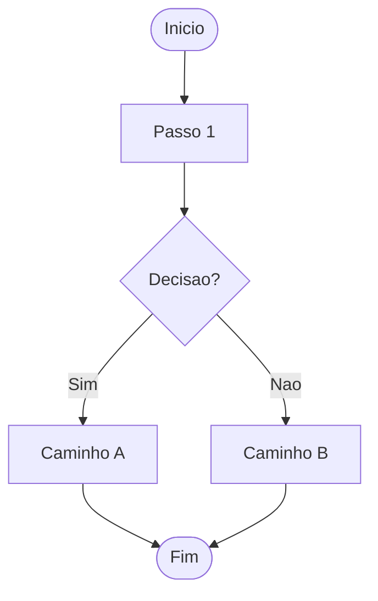
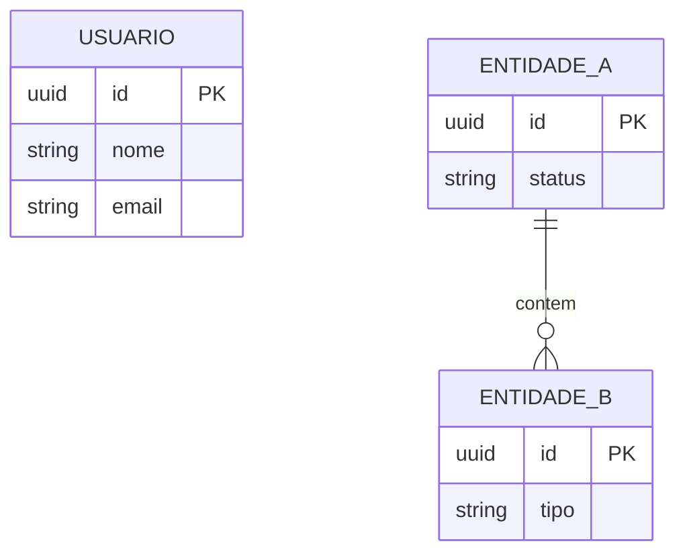
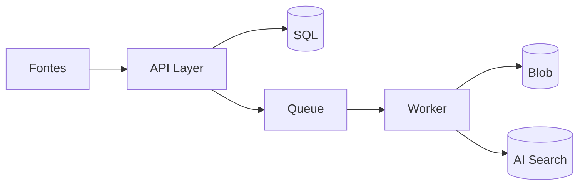
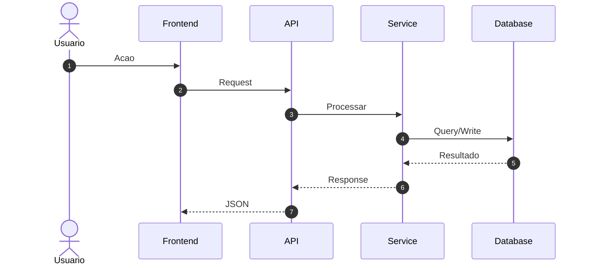

# Architecture — {PROJETO}

**Versão:** 1.0  
**Data:** {DATA}  
**Autor:** @architect (Aria)  
**Metodologia:** TOGAF 10 — ADM Phases A–E  
**PRD:** [prd.md](../prd/prd.md)  
**Status:** Draft | In Review | Approved

---

## Phase A — Architecture Vision

### A.1 Declaração de Problema de Negócio

**Capacidade atual (As-Is):** ...  
**Capacidade alvo (To-Be):** ...  
**Gap:** ...

### A.2 Princípios Arquiteturais

| # | Princípio | Implicação |
|---|-----------|-----------|
| PA-01 | Security by Design | Autenticação e RBAC implementados desde o MVP |
| PA-02 | Observability First | Logs, métricas e traces em todos os serviços |
| PA-03 | API-First | Contratos definidos antes da implementação |
| PA-04 | {Princípio específico do projeto} | {implicação} |

### A.3 Stakeholder Architecture Concerns

| Stakeholder | Preocupação | Como a arquitetura endereça |
|-------------|------------|---------------------------|
| {Sponsor} | Custo de operação | PaaS reduz overhead operacional |
| {Dev team} | Velocidade de entrega | Monolito modular reduz coordenação |
| {Security} | Compliance | Criptografia e trilha de auditoria |

### A.4 Diagrama de Contexto (C4 Level 1)

```mermaid
architecture-beta
  group internet(mdi:web)[Internet]
  group cloud(azure:azure)[Azure Cloud]

  service users(mdi:account-group)[Usuarios] in internet
  service apim(azure:api-management)[API Gateway] in cloud
  service app(azure:app-service)[Aplicacao] in cloud
  service db(azure:sql-database)[Database] in cloud
  service aad(azure:azure-active-directory)[Entra ID] in cloud

  users:R --> L:apim
  apim:R --> L:app
  app:R --> L:db
  app:T --> B:aad
```



### A.5 Classificação de Complexidade

| Dimensão | Score (1-5) | Justificativa |
|----------|------------|--------------|
| Escopo | | |
| Integração | | |
| Infraestrutura | | |
| Conhecimento | | |
| Risco | | |
| **Total** | **/25** | |

**Classe:** SIMPLE / STANDARD / COMPLEX  
**Estilo recomendado:** {Monolito Modular / BFF+SPA / Microservices / Event-Driven}

---

## Phase B — Business Architecture

### B.1 Mapa de Capacidades de Negócio

```mermaid
mindmap
  root({PROJETO})
    Dominio A
      Capacidade 1
      Capacidade 2
    Dominio B
      Capacidade 3
      Capacidade 4
```

### B.2 Fluxo de Processo — To-Be



### B.3 Matriz Ator × Capacidade

| Capacidade | {Persona 1} | {Persona 2} | {Admin} |
|-----------|------------|------------|--------|
| {Capacidade 1} | CRUD | Leitura | CRUD |
| {Capacidade 2} | - | CRUD | CRUD |

---

## Phase C — Information Systems Architecture

### C1 — Data Architecture

#### C1.1 Diagrama ER Conceitual



#### C1.2 Estratégia de Armazenamento

| Tipo de Dado | Tecnologia | Justificativa | NFR coberto |
|-------------|-----------|--------------|------------|
| Dados transacionais | Azure SQL | ACID e governança | NFR-XXX |
| Arquivos e mídia | Azure Blob Storage | Durabilidade | NFR-XXX |
| Dados de busca | Azure AI Search | Recuperação híbrida | NFR-XXX |
| Logs e telemetria | Azure Monitor / Log Analytics | Operações e auditoria | NFR-XXX |

#### C1.3 Fluxo de Dados Principais



#### C1.4 Política de Dados Pessoais

| Dado Pessoal | Onde Armazenado | Criptografado | Retenção | Exclusão |
|-------------|----------------|--------------|---------|---------|
| {Dado} | {Store} | Sim | {Prazo} | {Regra} |

### C2 — Application Architecture

#### C2.1 Catálogo de Componentes

| Componente | Responsabilidade | Tecnologia | Expõe | Consome |
|-----------|-----------------|-----------|-------|---------|
| Frontend | Interface do usuário | React | - | API REST |
| API Gateway | Roteamento e auth | APIM | REST | Services |
| Service A | Domínio principal | ASP.NET Core | REST | DB, Queue |
| Service B | Processamento async | Functions | - | Queue, Blob |

#### C2.2 Diagrama de Container (C4 Level 2)

```mermaid
architecture-beta
  group fe(mdi:monitor)[Frontend]
  group be(azure:app-service)[Backend]
  group data(azure:sql-database)[Data]

  service spa(mdi:web)[Web App] in fe
  service api(azure:api-management)[API Management] in be
  service svc(azure:app-service)[Service] in be
  service func(azure:functions)[Functions] in be
  service db(azure:sql-database)[SQL] in data
  service blob(azure:storage-accounts)[Blob] in data

  spa:R --> L:api
  api:R --> L:svc
  api:B --> T:func
  svc:R --> L:db
  func:R --> L:blob
```



#### C2.3 Diagrama de Sequência — Fluxo Principal



---

## Phase D — Technology Architecture

### D.1 Diagrama de Tecnologia

```mermaid
architecture-beta
  group edge(azure:front-door)[Edge]
  group app(azure:app-service)[Application]
  group data(azure:sql-database)[Data]
  group sec(azure:key-vault)[Security]

  service fd(azure:front-door)[Front Door] in edge
  service apim(azure:api-management)[APIM] in edge
  service web(azure:app-service)[App Service] in app
  service fn(azure:functions)[Functions] in app
  service sql(azure:sql-database)[SQL] in data
  service kv(azure:key-vault)[Key Vault] in sec

  fd:R --> L:apim
  apim:R --> L:web
  apim:B --> T:fn
  web:R --> L:sql
  web:T --> B:kv
```



### D.2 Padrões de Rede e Segurança

- Entra ID para autenticação.
- RBAC por papel de negócio e revisão.
- Segredos em Key Vault.
- TLS em trânsito e criptografia em repouso.
- Auditoria imutável orientada a eventos.

### D.3 Estratégia CI/CD


### D.4 Observabilidade

| Pilar | Ferramenta | O que monitora |
|-------|-----------|---------------|
| Logs | Log Analytics | Erros e auditoria |
| Métricas | Azure Monitor | Latência, throughput |
| Traces | App Insights | Fluxos E2E |
| Alertas | Azure Monitor Alerts | SLA e falhas críticas |

---

## Phase E — Opportunities & Solutions

### E.1 Work Packages

| WP | Nome | Fase TOGAF | Componentes | Sprint |
|----|------|-----------|------------|--------|
| WP-01 | Foundation & Security | D | Entra, Key Vault, CI/CD | S1 |
| WP-02 | Core Domain | C2 | API, DB | S1-S2 |
| WP-03 | Async Processing | C2+D | Queue, Worker | S2 |
| WP-04 | Search and Retrieval | C1+C2 | AI Search | S2-S3 |

### E.2 Sequência de Entrega

```mermaid
gantt
  title Roadmap de Entrega - {PROJETO}
  dateFormat  YYYY-MM-DD
  section Foundation
    WP-01: Foundation & Security :a1, {DATA_INICIO}, 2w
  section Build
    WP-02: Core Domain          :a2, after a1, 4w
    WP-03: Async Processing     :a3, after a2, 2w
    WP-04: Search and Retrieval :a4, after a2, 2w
```

### E.3 Build vs Buy vs Integrate

| Componente | Decisão | Ferramenta/Produto | Justificativa |
|-----------|---------|-------------------|--------------|
| Auth | Integrate | Entra ID | SSO e governança |
| Search | Build on managed service | Azure AI Search | Relevância e velocidade |
| AI extraction | Integrate | Azure AI services | Menor time-to-value |

---

## Enrichment Section A - Generic Verified Inputs

| Input | Status | Notes |
|---|---|---|
| Discovery Briefing | Reviewed | Primary context |
| PRD | Reviewed | Functional baseline |
| Load assumption | {Status} | {Users} |
| Volume assumption | {Status} | {Artifacts} |
| Ingestion sources | {Status} | Manual + M365 sources |
| AI governance | Confirmed | Human-in-the-loop mandatory |

---

## Enrichment Section B - Generic Use Case Segmentation

| Use Case ID | Use Case | Domain |
|---|---|---|
| UC-A1 | {Use case} | {Domain A} |
| UC-A2 | {Use case} | {Domain A} |
| UC-B1 | {Use case} | {Domain B} |
| UC-B2 | {Use case} | {Domain B} |

---

## Enrichment Section C - Generic Use Case Risk/Issue/Dependency Registers

### Contract Domain Register

| ID | Type | Item | Status | Impact | Mitigation |
|---|---|---|---|---|---|
| C-01 | Risk | {Risk} | Open | High | {Mitigation} |
| C-02 | Issue | {Issue} | Open | Medium | {Action} |
| C-03 | Dependency | {Dependency} | Open | High | {Owner/Plan} |

### Valuation Domain Register

| ID | Type | Item | Status | Impact | Mitigation |
|---|---|---|---|---|---|
| V-01 | Risk | {Risk} | Open | High | {Mitigation} |
| V-02 | Issue | {Issue} | Open | Medium | {Action} |
| V-03 | Dependency | {Dependency} | Open | High | {Owner/Plan} |

---

## Enrichment Section D - Generic Shared Fallback and Trade-Off Matrix

| Scenario | Primary Path | Fallback | Trade-Off |
|---|---|---|---|
| Source sync outage | Graph sync | Manual upload | Reduced automation |
| LLM outage | Primary model | Secondary model/manual queue | Lower automation |
| Token spike | Rich context prompts | Reduced context prompts | Lower nuance |
| Search degradation | Hybrid search | Metadata/keyword search | Lower convenience |

---

## Enrichment Section E - Generic Team, RART, ADR Snapshots

### Team Snapshot

| Role | Start Week | End Week | Seniority | Qty |
|---|---|---|---|---|
| Solution Architect | 1 | 18 | Senior | 1 |
| Tech Lead | 2 | 18 | Senior | 1 |
| Backend Engineer | 4 | 18 | Mid/Senior | 2 |
| Frontend Engineer | 4 | 18 | Mid/Senior | 1 |
| Data Engineer | 3 | 16 | Senior | 1 |
| AI Engineer | 3 | 16 | Senior | 1 |
| QA | 6 | 18 | Mid | 1 |

### RART Snapshot

| Area | Baseline |
|---|---|
| Requirements | R1..R10 mapped |
| Assumptions | A1..A8 tracked |
| Risks | K1..K8 tracked |
| Technology | Microsoft-native baseline |

### ADR Snapshot

- ADR-001: Modular monolith for Phase 1.
- ADR-002: Shared core + domain modules.
- ADR-003: Mandatory SME validation before trusted publication.
- ADR-004: Tiered AI routing with fallback.

---

## Checklist de Qualidade

- [ ] Phase A completo com contexto e princípios
- [ ] Phase B com capacidades e fluxo To-Be
- [ ] Phase C1 com dados e fluxo
- [ ] Phase C2 com componentes e sequência
- [ ] Phase D com tecnologia, segurança e observabilidade
- [ ] Phase E com work packages e roadmap
- [ ] Seções de enriquecimento preenchidas conforme RFP
- [ ] Riscos, issues e dependências por use case documentados
- [ ] ADRs e trade-offs explícitos

---

## Histórico de Versões

| Versão | Data | Autor | Mudança |
|--------|------|-------|---------|
| 1.0 | {DATA} | @architect | Estrutura base preservada + seções genéricas de enriquecimento para RFP |
